# Lonora — المخطط المعماري الكامل وتدفق النظام

> هذا الملف يصف البنية المستهدفة لـ **Lonora** كما تم الاتفاق عليها: إطار وكلاء دائمين مشتق من فلسفة وبنية Rakazo، مع Backend بلغة Python، وواجهة Web بـ React/TypeScript، وطبقة تشغيل دائمة، وتوجيه عالمي للنماذج، وصوت لحظي، وقدرات سوق ورسوم وتداول ومراقبة ضمن نفس Agent Runtime.

---

## 1. المخطط المعماري الكامل

```mermaid
flowchart TB

    U[المستخدم]

    subgraph CLIENT["طبقة العميل"]
        WEB[Web App<br/>React / TypeScript]
        TEXT[محادثة نصية]
        VOICEUI[مكالمة صوتية مباشرة]
        GROUPUI[مجموعات الوكلاء]
        SEARCHUI[البحث]
        SETTINGSUI[الإعدادات العامة]
        TRADEUI[واجهة السوق والتداول]
    end

    U --> WEB
    WEB --> TEXT
    WEB --> VOICEUI
    WEB --> GROUPUI
    WEB --> SEARCHUI
    WEB --> SETTINGSUI
    WEB --> TRADEUI

    subgraph API["طبقة API — Python / FastAPI"]
        AUTH[Authentication / Authorization]
        GATEWAY[API Gateway / REST / RPC]
        THREADAPI[Threads / Messages]
        RUNAPI[Runs / Steering]
        GROUPAPI[Groups]
        ROUTINEAPI[Routines]
        ARTAPI[Artifacts / Files]
        SEARCHAPI[Search]
        SETTINGSAPI[Global Settings]
        VOICEAPI[Voice Session API]
        TRADINGAPI[Trading API]
    end

    WEB -->|HTTPS / RPC| GATEWAY
    GATEWAY --> AUTH
    GATEWAY --> THREADAPI
    GATEWAY --> RUNAPI
    GATEWAY --> GROUPAPI
    GATEWAY --> ROUTINEAPI
    GATEWAY --> ARTAPI
    GATEWAY --> SEARCHAPI
    GATEWAY --> SETTINGSAPI
    GATEWAY --> VOICEAPI
    GATEWAY --> TRADINGAPI

    subgraph STATE["الحالة والتخزين الدائم"]
        PG[(PostgreSQL)]
        ART[(Artifact Storage)]

        BOTS[Bots]
        THREADS[Threads]
        MSGS[Messages]
        RUNS[Runs]
        EVENTS[Durable Thread Events]
        MEMORY[Memory Documents / MEMORY.md]
        SCRATCH[Scratchpad]
        SKILLS[Skills]
        ROUTINES[Routines]
        GROUPS[Groups]
        BOARDS[Boards / Tickets]
        WATCHES[Market Watches]
        TRJ[Trading Journal]
        SETTINGS[Global AI / Trading Settings]
    end

    THREADAPI --> PG
    RUNAPI --> PG
    GROUPAPI --> PG
    ROUTINEAPI --> PG
    SEARCHAPI --> PG
    SETTINGSAPI --> PG
    TRADINGAPI --> PG
    ARTAPI --> ART
    ARTAPI --> PG

    PG --- BOTS
    PG --- THREADS
    PG --- MSGS
    PG --- RUNS
    PG --- EVENTS
    PG --- MEMORY
    PG --- SCRATCH
    PG --- SKILLS
    PG --- ROUTINES
    PG --- GROUPS
    PG --- BOARDS
    PG --- WATCHES
    PG --- TRJ
    PG --- SETTINGS

    subgraph WORKER["Worker / التشغيل الدائم 24x7"]
        SCHED[Scheduler / Due Work]
        CLAIM[Run Claim<br/>Lease + Fence]
        BG[Background Worker]
        WAKE[Routine Wakeups]
        WATCHWORKER[Market Watch Processor]
        RECOVERY[Recovery / Reclaim Expired Runs]
        EVENTPUB[Event Publisher]
    end

    PG --> SCHED
    SCHED --> BG
    BG --> CLAIM
    WAKE --> CLAIM
    WATCHWORKER --> CLAIM
    RECOVERY --> CLAIM
    CLAIM -->|تشغيل Run| EXEC

    subgraph RUNTIME["Agent Runtime"]
        EXEC[Executor]

        STATE_MACHINE[Run State Machine]
        STEERING[Steering Consumption]
        WAITING[waiting_input / takeover / resume]
        CTX[Context Assembly]
        TOOLLOOP[Tool Loop]
        CHILD[Child Bots]
        SUBAGENT[Subagents]
        BOT2BOT[Bot-to-Bot Messaging]
        OUTCOME[Outcome Return]
        ENGAGE[Group Engagement / Silence]
        CANCEL[Cancellation / Stale Write Protection]
    end

    EXEC --> STATE_MACHINE
    EXEC --> STEERING
    EXEC --> WAITING
    EXEC --> CTX
    EXEC --> TOOLLOOP
    EXEC --> CHILD
    EXEC --> SUBAGENT
    EXEC --> BOT2BOT
    EXEC --> OUTCOME
    EXEC --> ENGAGE
    EXEC --> CANCEL

    subgraph CONTEXT["مصادر السياق"]
        HISTORY[Conversation History]
        MEMCTX[MEMORY.md / Memory]
        SCRATCHCTX[Scratchpad]
        SKILLCTX[Skills]
        REPLYCTX[Reply / Quote Context]
        STEERCTX[Steering Messages]
        TOOLCTX[Tool Results]
        GROUPCTX[Group Context]
        ROUTINECTX[Routine Context]
        ATTACHCTX[Attachments / Artifacts]
        MARKETCTX[Market / Account Context]
    end

    HISTORY --> CTX
    MEMCTX --> CTX
    SCRATCHCTX --> CTX
    SKILLCTX --> CTX
    REPLYCTX --> CTX
    STEERCTX --> CTX
    TOOLCTX --> CTX
    GROUPCTX --> CTX
    ROUTINECTX --> CTX
    ATTACHCTX --> CTX
    MARKETCTX --> CTX

    PG --> HISTORY
    PG --> MEMCTX
    PG --> SCRATCHCTX
    PG --> SKILLCTX
    PG --> STEERCTX
    PG --> GROUPCTX
    PG --> ROUTINECTX
    ART --> ATTACHCTX

    subgraph ROUTER["Global Model Router"]
        ROUTERCORE[Global Router]

        UNIFIED[Unified Mode]
        CUSTOM[Custom Capability Routing]

        CHAT[Conversation]
        REASON[Reasoning]
        RESEARCH[Research]
        VISION[Vision]
        REALTIME[Realtime Voice]
        STTROUTE[STT]
        TTSROUTE[TTS]
        BACKGROUND[Background]
    end

    CTX --> ROUTERCORE
    ROUTERCORE --> UNIFIED
    ROUTERCORE --> CUSTOM
    CUSTOM --> CHAT
    CUSTOM --> REASON
    CUSTOM --> RESEARCH
    CUSTOM --> VISION
    CUSTOM --> REALTIME
    CUSTOM --> STTROUTE
    CUSTOM --> TTSROUTE
    CUSTOM --> BACKGROUND

    subgraph MODELS["مزودو النماذج"]
        OPENAI[OpenAI]
        ANTHROPIC[Anthropic]
        DEEPSEEK[DeepSeek]
        ZAI[Z.ai]
        OPENROUTER[OpenRouter]
    end

    ROUTERCORE --> OPENAI
    ROUTERCORE --> ANTHROPIC
    ROUTERCORE --> DEEPSEEK
    ROUTERCORE --> ZAI
    ROUTERCORE --> OPENROUTER

    MODELS -->|Text / Tool Calls / Structured Output| TOOLLOOP

    subgraph TOOLS["Tool Runtime"]
        MEMTOOLS[Memory Tools]
        SKILLTOOLS[Skill Tools]
        ROUTINETOOLS[Routine Tools]
        SEARCHTOOLS[Search / Research Tools]
        FILETOOLS[Artifacts / File Tools]
        GROUPTOOLS[Group / Collaboration Tools]
        MCPTOOLS[MCP / Connector Tools]
        MARKETTOOLS[Market Tools]
        CHARTTOOLS[Chart Tools]
        ACCOUNTTOOLS[Account Tools]
        TRADETOOLS[Trade Tools]
        WATCHTOOLS[Watch Tools]
    end

    TOOLLOOP --> MEMTOOLS
    TOOLLOOP --> SKILLTOOLS
    TOOLLOOP --> ROUTINETOOLS
    TOOLLOOP --> SEARCHTOOLS
    TOOLLOOP --> FILETOOLS
    TOOLLOOP --> GROUPTOOLS
    TOOLLOOP --> MCPTOOLS
    TOOLLOOP --> MARKETTOOLS
    TOOLLOOP --> CHARTTOOLS
    TOOLLOOP --> ACCOUNTTOOLS
    TOOLLOOP --> TRADETOOLS
    TOOLLOOP --> WATCHTOOLS

    MEMTOOLS --> PG
    SKILLTOOLS --> PG
    ROUTINETOOLS --> PG
    FILETOOLS --> ART
    GROUPTOOLS --> PG
    WATCHTOOLS --> PG

    subgraph TRADING["طبقة السوق والتداول"]
        MARKET[Market Data]
        CHART[Chart Domain]
        IND[Indicators]
        ACCOUNT[Account / Positions / Orders]
        CONTROL[Trading ON / OFF<br/>Emergency Stop]
        EXECUTION[Execution Service]
        IDEMP[Idempotency]
        JOURNAL[Execution Journal]
        RECON[Broker Reconciliation]
        WATCHENG[Watch Engine]
    end

    MARKETTOOLS --> MARKET
    CHARTTOOLS --> CHART
    ACCOUNTTOOLS --> ACCOUNT
    TRADETOOLS --> CONTROL
    CONTROL --> EXECUTION
    EXECUTION --> IDEMP
    IDEMP --> JOURNAL
    JOURNAL --> RECON
    WATCHTOOLS --> WATCHENG

    MARKET --> MARKETCTX
    CHART --> MARKETCTX
    ACCOUNT --> MARKETCTX

    subgraph BROKERS["Broker Layer"]
        BROKERIF[Broker-neutral Interface]
        META[MetaApi Adapter / First Broker]
        FUTURE[Future Broker Adapters]
        FAKE[Demo / Fake Broker]
    end

    MARKET --> BROKERIF
    ACCOUNT --> BROKERIF
    RECON --> BROKERIF
    EXECUTION --> BROKERIF

    BROKERIF --> META
    BROKERIF --> FUTURE
    BROKERIF --> FAKE

    subgraph VOICE["الصوت الفوري"]
        WEBRTC[WebRTC Session]
        LIVEKIT[LiveKit Transport]
        STT[Speech-to-Text]
        SAMEAGENT[Same Agent Runtime]
        TTS[Text-to-Speech]
        BARGE[Barge-in / Interrupt]
    end

    VOICEUI --> WEBRTC
    WEBRTC --> LIVEKIT
    LIVEKIT --> STT
    STT --> SAMEAGENT
    SAMEAGENT --> CTX
    SAMEAGENT --> ROUTERCORE
    ROUTERCORE --> TTS
    TTS --> LIVEKIT
    LIVEKIT --> VOICEUI
    BARGE --> SAMEAGENT

    subgraph EVENTS_LAYER["الأحداث والتحديث اللحظي"]
        DURABLE[Durable Events]
        STREAM[Transient Streaming]
        WS[WebSocket / Event Stream]
        RECONNECT[Reconnect / Catch-up]
    end

    MSGS --> DURABLE
    RUNS --> DURABLE
    EXEC --> STREAM
    TOOLLOOP --> STREAM
    DURABLE --> WS
    STREAM --> WS
    WS --> WEB
    WEB --> RECONNECT
    RECONNECT --> EVENTS

    EXEC -->|Assistant Message| MSGS
    EXEC -->|Run State| RUNS
    EXEC -->|Durable Events| EVENTS
    EXEC --> EVENTPUB
    EVENTPUB --> EVENTS

    subgraph EXTERNAL["الأنظمة الخارجية"]
        NEWS[Web / News / Research]
        CONNECTORS[External Connectors / MCP]
        NOTIFY[Push / Email / Telegram]
    end

    SEARCHTOOLS --> NEWS
    MCPTOOLS --> CONNECTORS
    EVENTPUB --> NOTIFY
```

---

## 2. المسار الأساسي للرسالة النصية

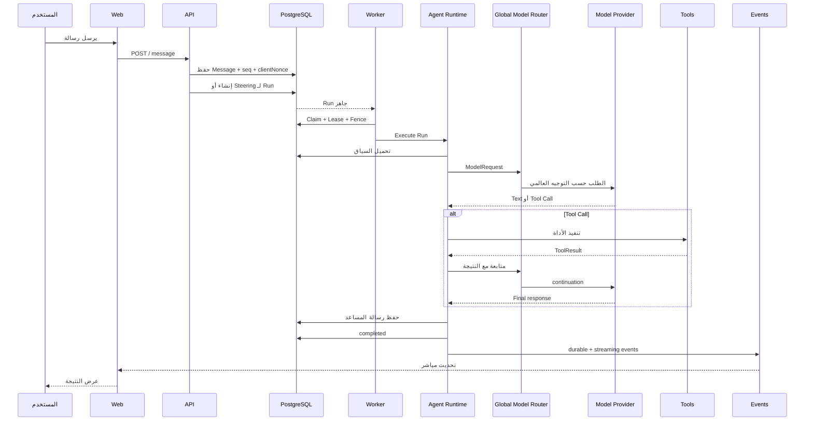

---

## 3. مسار Steering أثناء عمل الوكيل

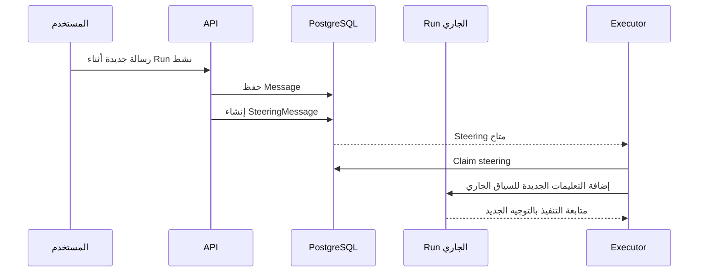

---

## 4. مسار الاستعادة بعد تعطل Worker

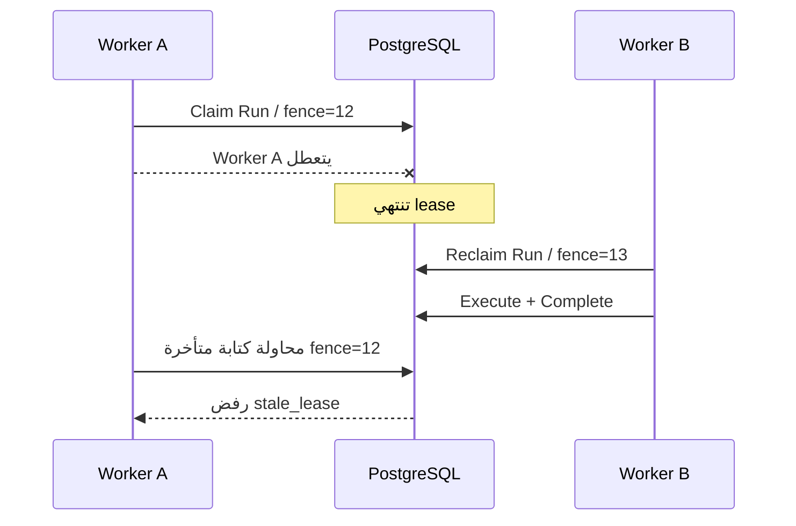

---

## 5. بناء Context للوكيل

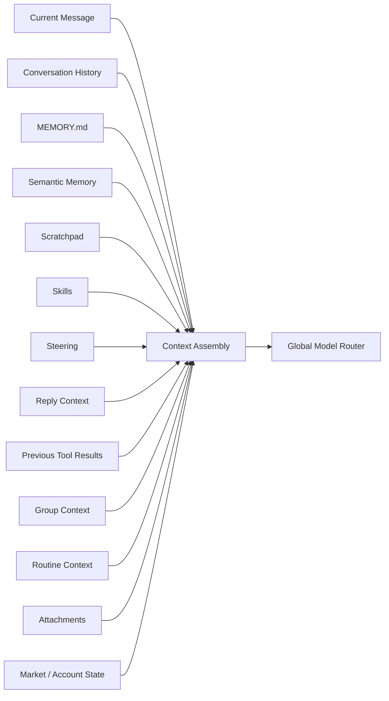

---

## 6. تعاون الوكلاء

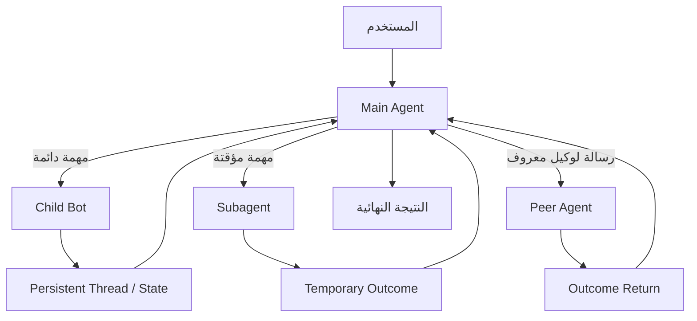

### الفرق

- **Child Bot**: وكيل دائم له هوية وThread وحالة مستقلة.
- **Subagent**: تنفيذ فرعي مؤقت ومحدود.
- **Bot-to-Bot**: وكيل موجود يرسل مهمة أو رسالة إلى وكيل موجود آخر.
- **Group Chat**: عدة وكلاء يشتركون في Thread واحد، ولا يجب أن يرد الجميع دائمًا.

---

## 7. تدفق Group Chat

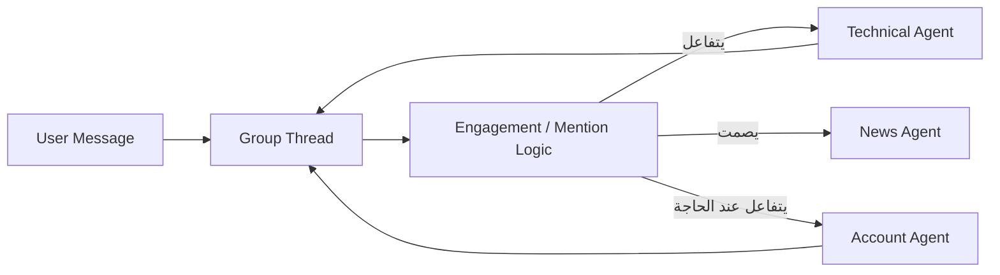

---

## 8. تدفق Routine

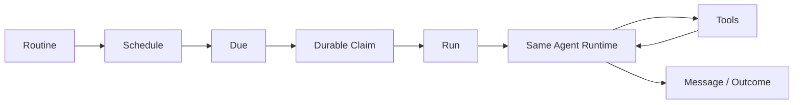

---

## 9. تدفق Market Watch

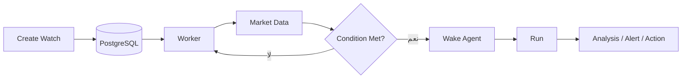

---

## 10. تدفق تحليل السوق

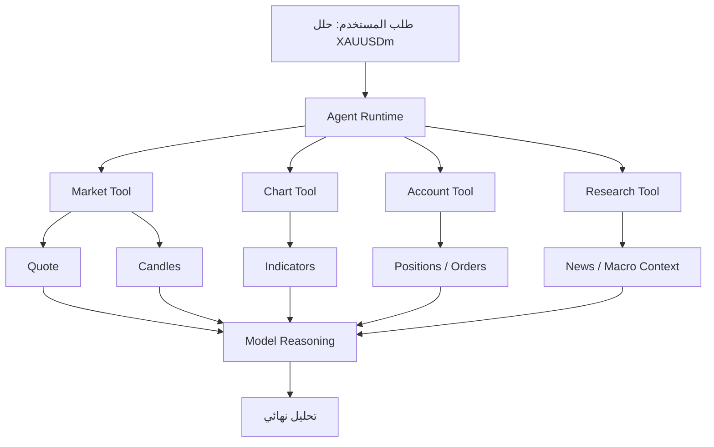

---

## 11. تدفق تنفيذ صفقة

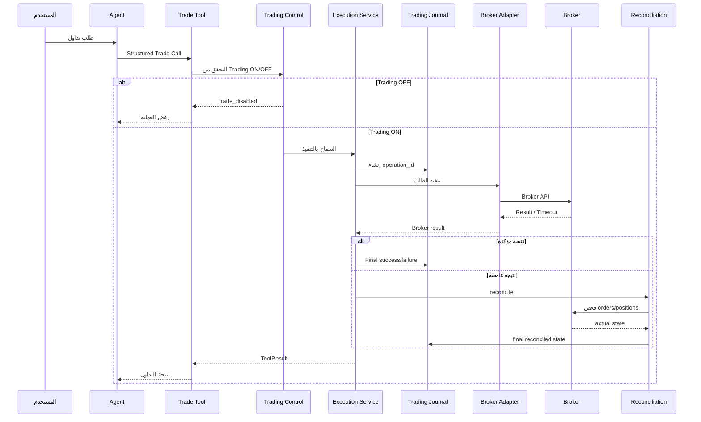

---

## 12. قاعدة الرمز الحقيقي للوسيط

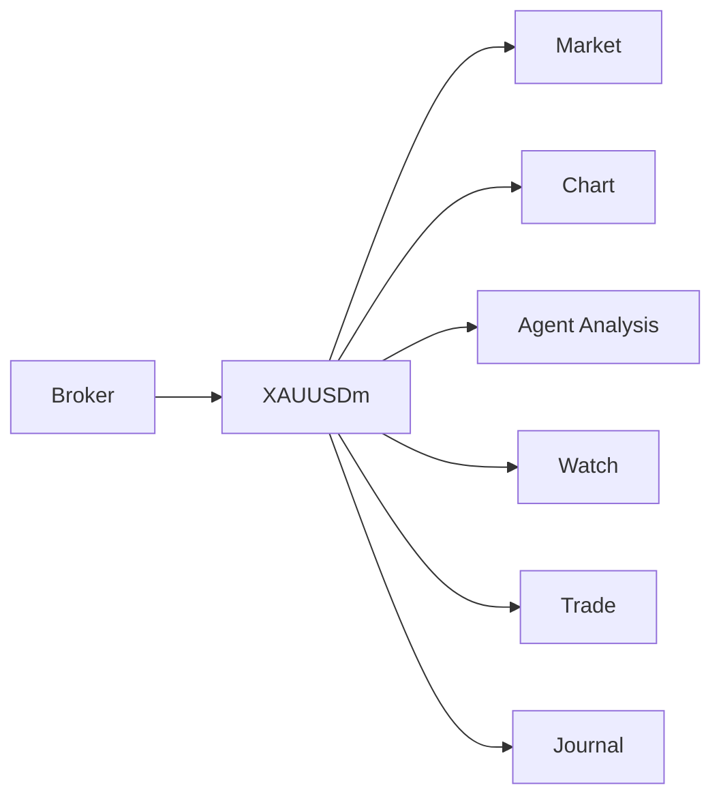

> لا يتم استبدال `XAUUSDm` تلقائيًا بـ `XAUUSD`.

---

## 13. تدفق الصوت الفوري

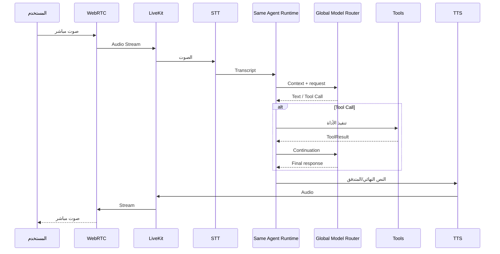

---

## 14. الصوت والتداول يستخدمان نفس المسار

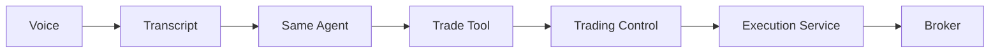

> لا يوجد مسار تداول خاص بالصوت يتجاوز أدوات الوكيل العادية.

---

## 15. التوجيه العالمي للنماذج

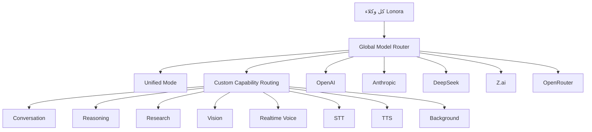

> لا يوجد Model/Provider مستقل لكل Agent أو Routine. التوجيه عالمي، مع إمكانية تسجيل الـmodel الفعلي المستخدم داخل Run metadata.

---

## 16. التشغيل أثناء إغلاق المتصفح

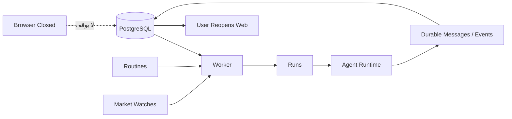

---

## 17. دورة النظام الكاملة

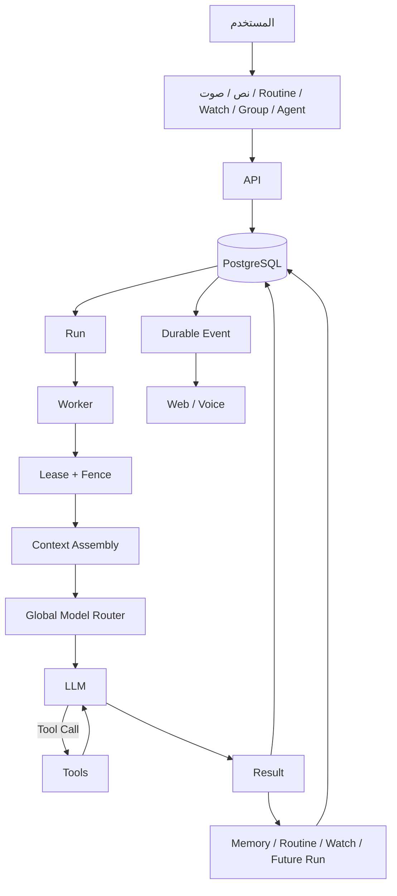

---

## 18. المبدأ المعماري الأساسي

Lonora ليس مجموعة أنظمة منفصلة:

```text
Chat System
Voice System
Trading System
Scheduler
Agent System
```

بل إطار واحد:

```text
Persistent Agent Runtime
        │
        ├── Conversation
        ├── Memory
        ├── Skills
        ├── Tools
        ├── Routines
        ├── Collaboration
        ├── Voice
        ├── Market
        ├── Chart
        ├── Trading
        └── Watches
```

جميع القدرات تستخدم نفس:

- هوية الوكيل
- Thread
- Context
- Memory
- Tool Runtime
- Run lifecycle
- Worker
- Security
- Events
- PostgreSQL durable state

وهذا هو جوهر تصميم Lonora.
