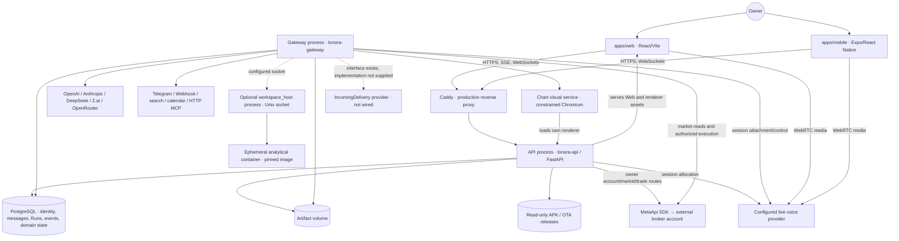
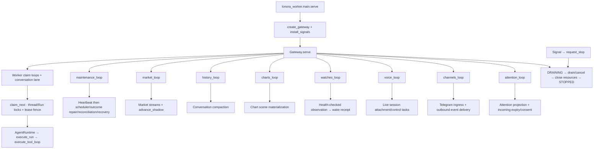
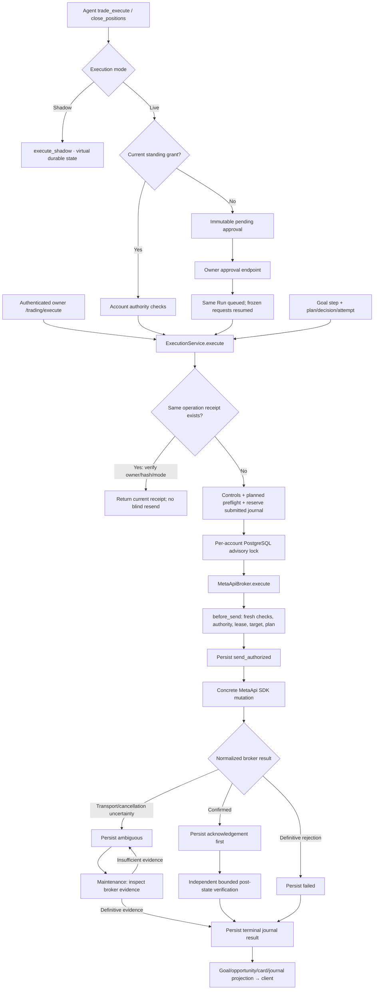
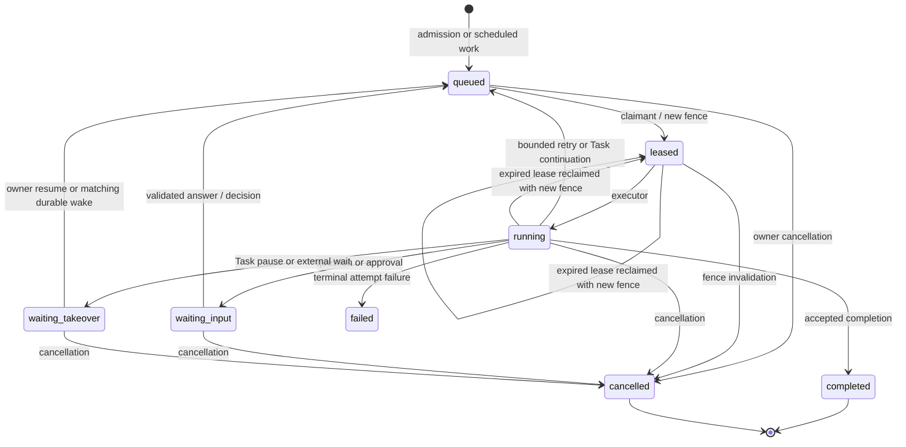
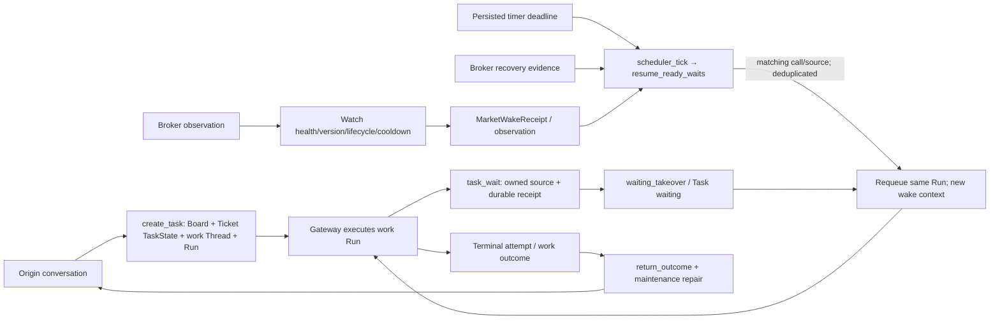
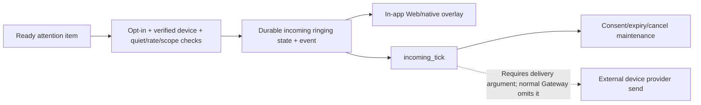
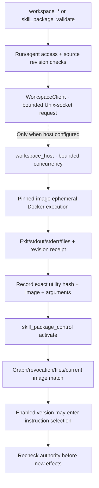
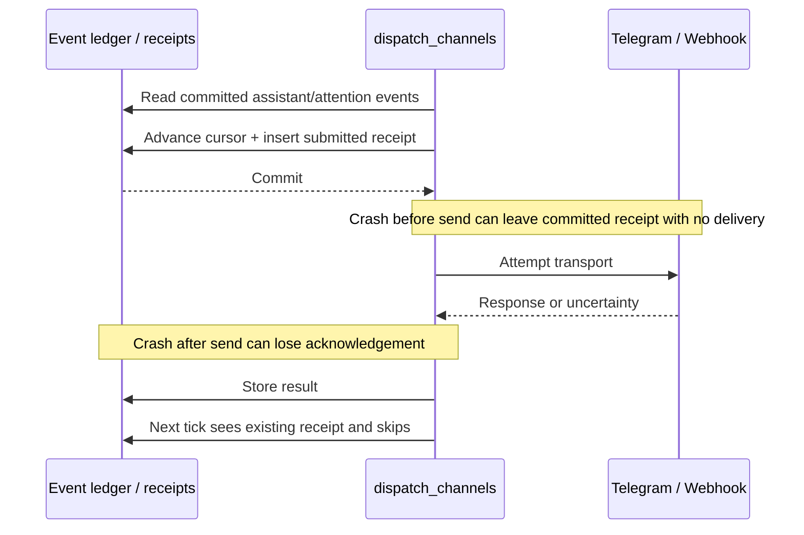

# Architecture diagrams derived from source

Baseline: `5315a8cc634486d54b1a64c1fd211b3e46429f14` · Audit date: 2026-10-27 · Source: this checkout.

[System](COMPLETE_SYSTEM_AUDIT.md) · [Capabilities](COMPLETE_CAPABILITY_INVENTORY.md) · [Traces](END_TO_END_EXECUTION_TRACES.md) · [Diagrams](ARCHITECTURE_DIAGRAMS.md) · [Findings](FINDINGS_AND_RECOMMENDATIONS.md) · [Coverage](AUDIT_COVERAGE_MANIFEST.md)


## Reading the diagrams

Solid edges describe source-connected calls/data paths. Dashed edges identify optional or explicitly unconnected boundaries. They do not mean an integration was live-tested. Package boxes are in-process responsibilities unless explicitly marked as a process. These diagrams cover the discovered major system and selected workflows; **they are not a claim of complete semantic coverage of every source branch**. See the [coverage manifest](AUDIT_COVERAGE_MANIFEST.md) and [execution traces](END_TO_END_EXECUTION_TRACES.md).

## D01. Discovered system and process boundaries



**Sources:** application assembly `apps/api/src/lonora_api/app.py:68`; worker entry `apps/worker/src/lonora_worker/main.py:10`; production processes/volumes `infra/compose/docker-compose.prod.yml:1`; per-owner services `packages/gateway/src/lonora_gateway/runtime.py:21`; optional socket `infra/analysis/compose.workspace.yml:4`; voice allocation `packages/voice/src/lonora_voice/sessions.py:73`; disconnected delivery `packages/gateway/src/lonora_gateway/service.py:160`.

The Web arrow represents static delivery, not a second backend in the browser. API and Gateway communicate through durable DB state; a Python in-memory queue is not the cross-process execution transport.

## D02. Gateway runtime responsibilities



**Sources:** `packages/gateway/src/lonora_gateway/service.py:77`, `:146`, `:163`; `packages/gateway/src/lonora_gateway/scheduler.py:8`; `packages/db/src/lonora_db/runs.py:128`; `packages/agent-runtime/src/lonora_agent/executor.py:33`. These are tasks in one resident process. Maintenance's sequential awaits explain the heartbeat latency risk; separate boxes do not imply independent fault isolation.

## D03. Message admission to durable answer

```mermaid
sequenceDiagram
  participant UI as Web / Expo client
  participant API as messages route
  participant DB as PostgreSQL
  participant GW as Gateway claimant
  participant Loop as execute_tool_loop
  participant Model as GlobalModelRouter / adapter
  participant Tool as ToolRegistry / handler
  UI->>API: MessageCreate(thread, nonce, text, optional refs)
  API->>DB: Lock owned thread; validate refs; deduplicate nonce
  alt Existing conversational Run
    API->>DB: Update input or append SteeringRow; maybe requeue
  else New work
    API->>DB: Insert MessageRow, RunRow, receipt and events
  end
  DB-->>API: Commit admission
  API-->>UI: Message + original Run identities/activity
  GW->>DB: claim_next; increment fence; lease
  GW->>Loop: ToolContext with current lease
  Loop->>DB: Restore checkpoint or load context
  Loop->>Model: Bounded messages + permitted tool schemas
  Model-->>Loop: Text / structured reply / tool proposals
  Loop->>DB: Persist pending calls and in-flight intent
  Loop->>Tool: Validate lease, schema, market and authority
  Tool-->>Loop: Result / wait / uncertainty
  Loop->>DB: Checkpoint or complete Run + Message + Event
  UI->>API: SSE or WS replay / canonical refresh
  API->>DB: Publish committed cursors; read owned events
  API-->>UI: Progress and durable result
```

**Sources:** `packages/db/src/lonora_db/messages.py:73`; `packages/db/src/lonora_db/runs.py:128`; `packages/agent-runtime/src/lonora_agent/tool_loop.py:165`; `packages/tools/src/lonora_tools/registry.py:157`; `packages/db/src/lonora_db/events.py:28`; `apps/web/src/providers/ClientProvider.tsx:16`. The acknowledgement occurs before model execution. External tool effects are handler-specific, not implied by this generic sequence.

## D04. Financial authority and actual send boundary



**Sources:** `apps/api/src/lonora_api/routes/trading.py:105`; `packages/tools/src/lonora_tools/trade.py:57`, `:269`; `packages/trading/src/lonora_trading/execution.py:126`, `:231`, `:365`; `packages/adapters/src/lonora_adapters/brokers/metaapi.py:773`; `packages/trading/src/lonora_trading/verification.py:14`; `packages/trading/src/lonora_trading/reconciliation.py:25`.

**Important defect marker:** F-01 applies between one explicit-approved batch result and the next request: current code continues after uncertainty. The diagram shows per-operation handling and must not be read as claiming that the batch stops correctly. Neither Shadow nor a confirmed tool response proves real settlement.

## D05. Selected persisted Run/Task transitions



**Sources:** `packages/core/src/lonora_core/run_state.py:6`; actual mutations in `packages/db/src/lonora_db/runs.py:128`, `packages/db/src/lonora_db/messages.py:290`, `packages/db/src/lonora_db/trade_approvals.py:65`, `packages/db/src/lonora_db/tasks.py:315`, `packages/db/src/lonora_db/task_wait.py:82`, `packages/db/src/lonora_db/cancellation.py:13`.

This is a selected Run transition view, not the entire contract or Task failure-recovery graph. Task state lives in TicketRow and can survive/recover attempts. Continuous Tasks cannot end from prose alone; `apply_stop_gates` and saved waits enforce that (`packages/agent-runtime/src/lonora_agent/stop_gates.py:55`). Direct-child cancellation and full descendant behavior must be distinguished (F-09).

## D06. Task/watcher wake and outcome return



**Sources:** `packages/db/src/lonora_db/tasks.py:94`; `packages/db/src/lonora_db/task_wait.py:21`; `packages/gateway/src/lonora_gateway/scheduler.py:8`; `packages/market/src/lonora_market/watchers.py:652`; `packages/agent-runtime/src/lonora_agent/collaboration/outcome_return.py:28`. Non-Task watches may create new watch Runs; the Task-owned branch intentionally resumes existing work.

## D07. Voice and incoming-call boundaries

```mermaid
sequenceDiagram
  participant Client as Web / native transport
  participant API as Voice session API
  participant DB as VoiceSession + canonical conversation
  participant Provider as Configured live provider
  participant GW as Gateway voice task
  participant Agent as Existing agent Run path
  Client->>API: Owned thread + nonce + offer
  API->>DB: Serialize admission; persist allocation receipt
  API->>Provider: Create remote live session
  Provider-->>API: Remote ID + answer SDP
  API->>DB: Persist joining session
  GW->>DB: Claim/maintain voice attachment
  GW->>Provider: Attach control/observation session
  GW->>DB: Connected state
  API-->>Client: Ready answer SDP after attachment
  Client->>Provider: WebRTC media
  Provider-->>GW: Transcript/control events
  GW->>DB: Canonical message handoff with correction/nonce metadata
  DB->>Agent: Same conversation execution
  Agent-->>DB: Durable result
  DB-->>GW: Result for voice delivery
  Note over GW,Agent: Provisional speech is not standing financial authority
```

**Sources:** `packages/voice/src/lonora_voice/sessions.py:73`; `packages/gateway/src/lonora_gateway/connection_manager.py:13`; `packages/voice/src/lonora_voice/realtime.py:180`; `packages/trading/src/lonora_trading/account_authority.py:21`. Actual provider negotiation/media was not executed in the audit.



**Sources:** `packages/voice/src/lonora_voice/incoming.py:140`, `:287`, `:333`; `packages/gateway/src/lonora_gateway/service.py:160`; `apps/mobile/app/_layout.tsx:38`. The missing edge is deliberately visible.

## D08. Optional workspace and skill admission



**Sources:** `packages/agent-runtime/src/lonora_agent/workspace_client.py:21`; `workspace_host.py:26`; `workspace.py:178`; `skills/lifecycle.py:347`, `:410`; `tool_loop.py:355`. The host/container was not started; a stored smoke test is not a general proof that a utility is safe/correct.

## D09. Event delivery and the outbound crash window



**Sources:** `packages/gateway/src/lonora_gateway/event_dispatch.py:95`, `:139`, `:144`, `:158`. This illustrates F-05, not an exactly-once guarantee. The separate Webhook numeric-status merge defect is at `:155` (F-02).

## Diagram validation limits

Source paths/line bounds and Markdown structure were checked during report validation. Mermaid blocks are provided as source diagrams; no Mermaid browser rendering or visual export was performed. They intentionally omit low-level branches still marked unresolved in the manifest. A future expanded diagram must come from completed trace evidence, not inferred boxes.
