# Lonora Cloud — master plan

**Status: Adopted by VISION.md Amendment 3 (2026-11-22)** ([draft record](AMENDMENT-3-DRAFT.md)).
Decisions referenced as `Dn` are in [DECISIONS.md](DECISIONS.md). Executable tasks are in [PHASES.md](PHASES.md).

---

## 0. Scope

**Goal.** A company that runs a dedicated, isolated Lonora for every customer, in the manner of managed hosts of
personal agents (one private, always-on instance per customer), with everything a company needs to compete
internationally: signup and billing, automated provisioning, a customer portal, an administration console, a
supervisors panel, a support desk, operations and reliability, security and compliance, legal, and go-to-market.

**Non-goals.**
- No change to what Lonora is or how its agents trade (VISION §1–§12). The product stays a delegated trading agent.
- No shared multi-owner database. One installation serves one owner (Amendment 3 §1).
- No change to the invisible safety core (VISION §6).
- No platform-sold model access (D6). No platform access to customers' Lonora, model keys or chats (D7, Amendment 3 §3).
  Broker connections are provided by the company's MetaApi account only through the provisioner of §3.8, which never
  trades and never stores a password (Amendment 3 §10).
- No use of Claude Code or the Agent SDK as Lonora's engine (VISION P4).

---

## 1. Product

**What the customer gets**
- **The Lonora Android app is the product (D36).** The website is only for signing up, paying and managing the
  account; after signup everything happens in the native app: agents, conversations, cards, voice, settings.
- Behind the app, their own Lonora at `https://<handle>.lonora.app` (D5), on a VM nobody else uses (D1): their own Linux
  workspace, database, encryption keys and backups. The web app stays reachable as a fallback (D37).
- Managed updates in their chosen window (D11), nightly encrypted backups shipped off the server, weekly automatic
  restore tests, workspace snapshots, monitoring, a status page and support in Arabic and English.

**What the customer brings**
- Model API keys (BYOK, VISION §12, D6), entered in chat inside their Lonora.
- Their MetaTrader account number, server and password, as their broker gave them. **No MetaApi account and no
  token**: the company's MetaApi account provides the connection and the company pays for it (D27, §3.8).
- Optionally a Telegram bot token.

**The promise (front page of the marketing site)**
> Your Lonora, your keys, your accounts. We run the servers. Only your Lonora trades your account. We never store your
> broker password, and we cannot sign in to your Lonora or read your model keys.

This is enforced by architecture (§3.4, §3.8), not only by policy, and it is the main differentiator against hosts
that operate a shared backend. Honest limit, stated on the security page: the company's MetaApi key can reach the
MetaApi connections it created. It lives in one isolated service that never trades, under the controls of §3.8, and
every use is shown to the customer.

---

## 2. Decision record: one installation per customer

| Evidence in this repository | Consequence |
|---|---|
| `get_owner()` selects `OwnerRow.singleton == 1` (`packages/db/src/lonora_db/owner.py`); `initialize_owner()` refuses a second owner (`packages/auth/src/lonora_auth/owner_policy.py`). | The schema is single-owner by construction. A shared database means rewriting every owner-scoped path. |
| VISION §6 guarantees are per installation (journal, idempotency, per-account send serialization). | A shared deployment would have to re-prove the safety core across tenants. A dedicated one inherits it untouched. |
| VISION §7.1: one workspace per owner, agents run arbitrary commands with internet egress; the workspace container holds `SETUID`/`SETGID`/`CHOWN` capabilities (`infra/compose/docker-compose.prod.yml`). | Untrusted code. Co-locating it on a shared kernel with other customers' broker credentials is the main risk to avoid → VM per customer (D1). |
| `docker-compose.prod.yml`, `install.sh`, the `lonora` CLI (update with digest pinning, backup, health gate and automatic rollback; encrypted backup; restore; restore-test; maintenance), systemd units and `harden-host.sh` exist and are tested for one owner per server. | The tenant plane is mostly *already built*. The new work is the control plane that drives N of them. |

Rejected alternatives: shared database with `tenant_id` (rewrites the product and the safety core); containers per
customer on shared hosts without extra isolation (kernel-sharing with untrusted code). Dense cells with gVisor/Kata for
the workspace are kept as a future cheaper tier (Phase 9) after a dedicated security review.

---

## 3. Architecture

### 3.1 Overview

```mermaid
flowchart LR
  subgraph Customer
    B[Browser] ; M[Mobile app]
  end
  subgraph Edge[Cloudflare]
    CF[DNS + proxy + WAF<br/>*.lonora.app]
  end
  subgraph Fleet[Customer fleet - one VM per customer]
    subgraph VM1[VM: alice]
      C1[Caddy origin cert] --> S1[Lonora prod stack<br/>api, gateway, db, workspace,<br/>searxng, browser]
      A1[host agent]
    end
    subgraph VM2[VM: bob]
      C2[Caddy] --> S2[Lonora stack] ; A2[host agent]
    end
  end
  subgraph CP[Control plane - separate cloud account]
    API[cloud-api] ; W[cloud-worker] ; P[portal-web my.] ; AD[admin-web admin.]
    DB[(Postgres PITR)] ; KMS[(KMS / Vault)] ; RELAY[push relay]
  end
  OBJ[(Object storage<br/>backups, object lock)]
  PROV[Cloud provider API] ; BILL[Billing provider] ; MAIL[Email provider]

  B --> CF --> C1
  M --> CF
  B --> P --> API
  A1 -- outbound mTLS, signed jobs --> API
  A2 -- outbound mTLS --> API
  A1 -- encrypted backups --> OBJ
  S1 -- push via relay token --> RELAY
  W --> PROV ; W --> CF ; API --> BILL ; API --> MAIL ; API --> KMS ; API --> DB
```



### 3.2 Tenant plane: the customer VM

| Layer | Content |
|---|---|
| OS | Ubuntu LTS minimal image, cloud-init, `infra/compose/harden-host.sh`, unattended security upgrades, Docker Engine + Compose plugin pinned to tested versions. |
| Lonora | Installed by `infra/compose/install.sh --domain <handle>.lonora.app --project lonora --version <release> --env-from <prepared .env> --workspace-memory … --workspace-cpus … --workspace-disk …`, then driven only by the `lonora` CLI. Origin-certificate TLS mode (P1-T3). |
| Workspace disk | `workspace.img` on a separate attached volume so it can be snapshotted and resized (D10). |
| Host agent | `lonora-host-agent` (systemd, root), outbound-only, runs signed allowlisted jobs (§10). |
| Network | Provider firewall: inbound TCP 443 from Cloudflare ranges only; no inbound SSH (staff shell only through short-lived certificates via an access proxy, dual approval, recorded). Outbound open (the workspace needs the internet) with SMTP 25 blocked and egress anomaly detection (§13.8). |
| Sizing | Installer preflight: free RAM ≥ 3584 MB + workspace memory, free disk ≥ 10 GB + workspace disk + 2 GB, ≥ 2 CPUs. Plans in §5. |

### 3.3 Control plane (`lonora-cloud`, D2)

| Service | Responsibility |
|---|---|
| `cloud-api` (FastAPI) | Portal API, staff API, host-agent API, billing/email/provider webhooks, push relay. |
| `cloud-worker` | Durable jobs with database leases: provisioning state machine, rollouts, backup verification, dunning, notifications, SLA timers, retention purges. |
| `portal-web` (React + Vite + Tailwind) | Customer portal at `my.lonora.app`. |
| `admin-web` (React + Vite + Tailwind) | Staff console at `admin.lonora.app`, including the supervisors panel; reachable only through a Zero Trust gateway. |
| `lonora-host-agent` | Runs on each customer VM (§10). |
| `broker-provisioner` | The only holder of the company's MetaApi API token. Creates, deploys, undeploys, updates and removes customers' MetaApi accounts and issues each instance a token narrowed to its own accounts (§3.8). Separate deployment, egress to MetaApi only. |
| Postgres | Managed, point-in-time recovery, multi-zone. |
| KMS / Vault | Signing keys, provider tokens, escrow decryption keys (D8). |
| Object storage | Backups per instance prefix, object lock (WORM), lifecycle by plan. |
| Third parties | Cloud provider (D3), Cloudflare (D4), billing (D16), transactional email, error tracking (scrubbed), metrics/logs stack (D26), external uptime probes, on-call paging. |

The control plane runs in a **different cloud account** from the fleet, with two or more application nodes behind a load
balancer. Workers coordinate through database leases (the same pattern Lonora's gateway uses), so replicas are safe.

### 3.4 What crosses between an instance and the control plane

| Allowed | Never |
|---|---|
| `lonora status --json`, `/ready`, service states, image digest and release, update/backup/restore-test results | Chats, memory, owner profile, agents' instructions |
| CPU, memory, disk, workspace usage, OOM kills, egress counters | Secrets, `.env` values, model keys, the instance's narrowed MetaApi token, broker passwords (except the one pass in §3.8) |
| Backup metadata (time, size, checksum) and the **encrypted** backup file | Decrypted backups (except DR under dual control, D8) |
| `owner_initialized: true/false` (public `GET /onboarding`) | Owner password, passkeys, sessions |
| Push requests through the relay (device token + title + body that the instance already sends to Expo) | Trading journal, positions, accounts, orders |
| To `broker-provisioner`: connect/rotate/remove requests (login, server, platform, and the password **once, in memory**, forwarded to MetaApi) | The password at rest anywhere in the control plane, or in any log |
| From `broker-provisioner`: MetaApi account ids, deployment/connection state, the narrowed token | Balances, positions, history, orders (the instance reads those from MetaApi itself) |
| Diagnostics bundle **only with the customer's consent per ticket** (scrubbed on the instance) | Raw service logs (break-glass only, §7.5) |

### 3.5 Domains, TLS and edge (D4, D5)

- Wildcard DNS record `*.lonora.app` is not used; each instance gets its own proxied record `<handle>` → VM IP, created
  by the provisioner through the Cloudflare API, so a destroyed instance stops resolving at once.
- Cloudflare Universal SSL covers first-level subdomains for browsers. Each VM gets its **own** Origin CA certificate
  (never a shared wildcard key: one compromised VM must not be able to impersonate others). Authenticated Origin Pulls
  makes Caddy accept only Cloudflare.
- Caddy maintenance mode (`infra/compose/Caddyfile.prod`, the `/maintenance/on` flag) keeps working; the 503 message is
  shown during updates and quiesce.
- To verify in Phase 1: Server-Sent Events on `/api/events/stream` through the proxy (no buffering, heartbeat under the
  proxy read timeout), uploads at Lonora's limits, WebRTC voice (direct to the model provider, not proxied).
- Custom domains (Max): Cloudflare for SaaS custom hostnames, CNAME to `<handle>.lonora.app`, ownership verification
  (Phase 8).
- Handles: 3–30 chars, `[a-z0-9-]`, reserved list (`www`, `my`, `admin`, `api`, `status`, `mail`, `support`, `app`,
  brand terms), profanity filter, immutable after provisioning (renaming = new domain + migration).

### 3.6 The Android app is the product (D36)

The customer installs one app and never needs the web app. It is the existing Expo app (`apps/mobile`), built as a
native Android app (React Native with native UI and Hermes, not a web page in a shell).

**What exists today (`apps/mobile/README.md`):** a signed universal release APK (Android 7/API 24+) with a private
release identity kept outside the repository; signed OTA updates with a pinned certificate; the first-run screen
«إعداد Lonora» that creates the owner on a new server; native sessions in SecureStore; Arabic-first RTL; conversations,
agents, groups, files, artifacts, charts, routines, memory and settings.

**What is missing for an app-only product.** The app is documented as a *companion surface*: provider and integration
configuration, financial execution controls, boards, skills/scratchpad/knowledge editing and realtime voice "remain in
the full Web interface", and some native settings open the matching Web dialog. That README is partly out of date
(later releases mention native voice work), so the first task is an audit against the current code (PM-T1). VISION §13
already requires completing "mobile screens missing where web and the server have them".

**Handoff from the website to the app.**
- After payment the portal shows **"Install from Google Play"** and **"Open in the app"**: a deep link
  `lonora://setup?server=https://<handle>.lonora.app&token=<bootstrap>` that opens the existing first-run screen with
  the server and setup token filled in (PM-T2). The owner chooses their password and passkey in the app (D7: the
  company never knows them).
- On another device the same link is shown as a QR code; manual server entry stays for self-hosters.
- After setup the app keeps the server and session; daily use never needs the website.

**Passkeys:** RP ID is the customer's own host; Android Digital Asset Links are served by each instance (it already
handles `LONORA_PASSKEY_*`), verified in P1-T9.

**Push:** native notifications through the relay (`LONORA_PUSH_RELAY_URL`, P1-T7, P3-T9): the relay holds the Expo
token and forwards only to devices the instance registered; it also carries the company's maintenance and billing
notices.

**Updates:** store releases for native changes; signed OTA for JavaScript changes, using the published channel
(`docs/mobile/ota.md`), never served by customer instances. `infra/release/compatibility.json` (`min_client_version`)
gates server rollouts (§13.3).

**Store and payments (D38, D39).** Google Play is the main channel and a signed APK from the website the fallback.
Purchases and plan changes happen only on the company website; the app shows the plan's state but sells nothing and
links to no purchase, so no store service fee applies (D39). Once Phase M is complete the customer's web app is turned
off (D37): the app is the only product surface, the website only the account.

### 3.7 Technology for `lonora-cloud`

Same stack as Lonora so one team and one set of Claude Code habits cover both: Python 3.12, FastAPI, SQLAlchemy 2 async,
Alembic, PostgreSQL 16, Pydantic contracts; React + Vite + Tailwind + TypeScript for the two web apps; pnpm + turbo;
Ruff, Pyright, Biome; pytest + Playwright. Infrastructure as code with OpenTofu. Brand tokens copied from
`docs/brand-kit.md` / `packages/ui-tokens` (a copy, not an import across repositories).

### 3.8 Broker connections through the company's MetaApi account (D27, Amendment 3 §10)

**What the customer does.** In chat: «عندي حساب MT5، تداول عليه». Lonora asks for the account number and the server,
shows the broker Secret card for the password (D30), and reports the balance when the connection is up. No visit to
metaapi.cloud, no token, no MetaApi bill.

**What Lonora does today.** One owner-scope secret `METAAPI_TOKEN` (`packages/db/src/lonora_db/secrets.py`) serves both
provisioning (`packages/trading/src/lonora_trading/broker_provisioning.py`,
`packages/adapters/src/lonora_adapters/brokers/metaapi_provisioning.py`, which sends each create with a stable
`transaction-id` so a resend never makes a second account) and trading (`packages/adapters/src/lonora_adapters/brokers/metaapi.py`,
only through the execution door). Token rotation is `replace_token` (`packages/trading/src/lonora_trading/broker_manage.py`).

**Facts read from the MetaApi SDK Lonora pins (`metaapi-cloud-sdk==29.1.1`).**
- Every provisioning call (create, deploy, undeploy, redeploy, update, delete, list, configuration link) requires an
  API (JWT) token (`clients/metaapi/metatrader_account_client.py`).
- A token can be narrowed by application, role and resource, for example to given account ids
  (`TokenManagementApi.narrow_down_token_resources`), with `validity_in_hours` (default 24 h). The SDK has no call to
  revoke a narrowed token before it expires.
- Hosts differ by function: provisioning `mt-provisioning-api-v1.<domain>`, token management `profile-api-v1.<domain>`,
  trading and account data `mt-client-api-v1…`, market data `mt-market-data-client-api-v1…`.
- `create_configuration_link(account_id, ttl_in_days)` yields a MetaApi page where the end user types login and
  password (the D30 alternative).
- MetaApi bills an account only while it is deployed; high-reliability accounts cost more. Exact rates and volume terms
  come from MetaApi (D32).

**To verify with a real company token in P0-T9:** the server's maximum `validity_in_hours`; the access-rule manifest
(`get_access_rules`) for a rule limited to trading and streaming on listed accounts; whether rotating the company token
invalidates tokens narrowed from it; whether a narrowed token can itself provision (it must not be needed).

**Design.**
1. **One holder.** `broker-provisioner` alone holds the company's MetaApi API token, in KMS/Vault, usable only by its
   workload identity. No person reads it; manual use needs two approvals, like key escrow (D8).
2. **Connect.** In hosted mode (`LONORA_BROKER_PROVISIONER_URL` set) the instance sends
   `create {login, server, platform, password, transaction_id}` over mTLS with its instance credential. The provisioner
   creates the MetaApi account in the MetaApi region nearest the broker server, tags it with the instance id, records
   `metaapi_account_id → instance_id`, deploys it at the D29 tier, and drops the password from memory once MetaApi has
   accepted it. The password is never written to the control plane's database, queues or logs (tested).
3. **Narrowed token.** The provisioner mints a token narrowed to **the set of this instance's account ids**, with
   trading and streaming roles only, valid per D31. The instance stores it as `METAAPI_TOKEN`, where the owner's token
   lives today, so the broker adapter and the execution door do not change at all.
4. **Renewal.** Re-minted on every connect or removal and on the D31 schedule, delivered by the host agent
   (`broker_token` job) or pulled by the instance; under 7 days of life left pages SRE. A control-plane outage shorter
   than a token's remaining life never stops trading.
5. **Management from chat** (VISION §9.3): password rotation, disconnect, enable/disable go to the provisioner, which
   acts only on accounts mapped to the calling instance. Lonora's stable `transaction-id` is passed through, so the
   existing no-duplicate-account guarantee holds end to end.
6. **Lifecycle.** Undeploy on suspension (billing stops), deploy on resume, delete on instance deletion. Positions stay
   at the broker and remain the owner's.
7. **Metering.** Deployed hours per account from the provisioner's deploy/undeploy events, reconciled monthly with
   MetaApi's invoice; feeds connection billing (D28) and the cost worksheet (§5.3).
8. **The provisioner cannot trade.** Its egress allowlist contains only the provisioning and token-management hosts;
   trading and account-data hosts are unreachable from it. Its code never imports the SDK's trading or streaming
   clients (static test). Every call is audited and listed to the customer ("connection created / renewed / removed").
9. **Containment.** A compromised customer VM holds a token narrowed to its own accounts and a credential the
   provisioner maps to its own accounts only. Response: undeploy or delete that MetaApi account (cuts access whatever
   the token's expiry) and ask the owner to change the broker password. The company token rotates quarterly and on any
   suspicion.
10. **Self-hosted Lonora is unchanged:** the owner's own MetaApi token, VISION §9.2 as written.

### 3.9 The open agent: any API, MCP and skill (Amendment 3 §11)

Lonora is an agent with its own computer, in the manner of Grok Bot (VISION §1, P3). Hosting keeps all of it.

**What a customer's agents can already do (in the code today)**

| Capability | How | Where |
|---|---|---|
| Call any API | The workspace has internet egress, any CLI tool, `pip`/`npm` installs, SSH, long-running processes, a headless browser; keys come from the generic Secret card and are injected as `NAME` and `/run/secrets/NAME` | VISION §7.1, §7.2, §12.2; `packages/workspace/` |
| Remote MCP servers | The owner trusts a server by a typed chat message; a static bearer credential today (the OAuth helpers in `oauth.py` exist but nothing calls them, so a server that signs in only by OAuth cannot be connected yet: OAuth sign-in is D45, PT-7, [mcp-oauth.md](../proposals/mcp-oauth.md)); read tier and non-financial write tier (receipt per call) | `docs/mcp-boundary.md`, `docs/trusted-sources.md`, `packages/adapters/src/lonora_adapters/mcp/` (`oauth.py`, `transport.py`), `packages/tools/src/lonora_tools/mcp.py` |
| Local (stdio) MCP servers | Run by an agent in the workspace as its own process, like any command | `docs/mcp-boundary.md` |
| Skills | From trusted public GitHub repositories, or written by agents in the workspace, every write versioned | `packages/agent-runtime/src/lonora_agent/skills/`, `docs/workspace-created-skills.md`, `docs/skill-repository-inspection.md` |

**Network rules the workspace really applies** (`packages/workspace/src/lonora_workspace/relay.py`, `egress.py`), to be
stated in the help centre so "any server" is not over-promised:
- Client-first connections must be **TLS, HTTP or SSH**, addressed **by name**. This covers HTTPS and secure WebSocket
  (data vendors, news and any web API), FIX over TLS, remote MCP, git and SSH. Raw tunnels, SOCKS and connections to
  a bare IP address are refused; server-first protocols pass once the server speaks.
- Private, link-local (including the cloud metadata address `169.254.169.254`) and reserved ranges are blocked, as are
  MetaApi's names and Lonora's own domain.
- At most 256 connections per agent user; idle connections close after an hour (streams with pings are unaffected).

**What hosting adds** (Amendment 3 §11): the cloud domain in `LONORA_WORKSPACE_BLOCKED_DOMAINS` (so a workspace cannot
reach other customers or the control plane), SMTP 25 blocked, and the abuse ladder of §13.8. Nothing else.

**Trading scope: MetaTrader only (VISION Amendment 2).** Lonora Cloud trades MT5 accounts through MetaApi
and the execution door, on **any symbol the customer's broker offers**: forex, metals, indices, energies, and stock or
crypto CFDs where that broker lists them. Symbols are the broker's own (`packages/tools/src/lonora_tools/symbols.py`);
nothing restricts which ones an agent may trade (`assert_market_binding` keeps only a fixed-market agent's charts,
watches and decisions on its pair and is never applied to orders). No crypto exchange is built, offered or supported.
Financial MCP tools stay untrusted by design (`docs/mcp-boundary.md`): money moves only through the door.

**Shipped on `main`:** the workspace refuses other trading venues by name (`OTHER_VENUE_DOMAINS` in
`packages/core/src/lonora_core/broker_endpoints.py`): crypto exchanges' domains and other brokers' trading API hosts do
not resolve and the relay refuses them. Their addresses are deliberately not blocked, because they sit behind CDN
addresses unrelated sites share. Agents' web research runs outside the workspace and still reads their public pages.

**Web research (D44).** Agents search with their provider's built-in search first (billed to the owner's key, about
$10 per 1,000 searches) and fall back to Lonora's own `web_search`: SearXNG from the customer's own VM address, GDELT
for news behind one limiter per instance. Spec: `docs/proposals/web-research.md` (PT-6).

**Honest gaps compared with nanobot's model** (from the nanobot floorplan): no skills marketplace with one-click
install (in Lonora the owner asks in chat and the agent installs from a trusted repository), no bundled "plugins" of
skills plus MCP servers, and stdio MCP servers are workspace processes rather than native tools. Each is a product
decision for `lonorabot` (D35), not a hosting limit.

---

## 4. Instance lifecycle

### 4.1 States

```mermaid
stateDiagram-v2
  [*] --> pending_payment
  pending_payment --> queued: paid or trial started
  queued --> creating_vm --> enrolling --> installing --> starting --> verifying --> awaiting_owner
  awaiting_owner --> active: owner_initialized
  active --> updating --> active
  active --> resizing --> active
  active --> migrating --> active
  active --> quiescing --> suspended
  suspended --> resuming --> active
  suspended --> deleting
  active --> deleting: cancelled at term end or deletion request
  deleting --> deleted
  creating_vm --> failed
  installing --> failed
  verifying --> failed
  failed --> queued: retry
  failed --> deleting: compensate
```

Every transition is a row in `instance_events` (actor, reason, job id). Every step is idempotent on
`(instance_id, step, attempt)`, retried with backoff, and has a compensation (destroy a half-built VM, remove its DNS
record, revoke its enrollment token). After three failed attempts the instance goes to `failed`, an internal ticket is
opened, and the customer sees "We are finishing your setup by hand; no action needed".

### 4.2 Provisioning steps (target: under 5 minutes from payment to setup link)

1. **queued → creating_vm:** choose region (D12) and size (plan); create firewall, VM with labels
   (`instance_id`, `plan`, `env`), attached workspace volume; cloud-init carries a single-use enrollment token
   (1 hour), the control-plane CA certificate and the job-signing public key.
2. **enrolling:** the host agent generates its key pair, enrolls with the token, receives a short-lived mTLS client
   certificate, reports facts (CPU, RAM, disk, kernel, Docker version).
3. **installing:** the agent runs the signed `install` job. Secrets (`LONORA_POSTGRES_PASSWORD`,
   `LONORA_ENCRYPTION_KEY`, `LONORA_BOOTSTRAP_TOKEN`, `LONORA_WEBHOOK_SECRET`, the backup key) are **generated on the VM**,
   never in the control plane. The agent seals `LONORA_ENCRYPTION_KEY` and the backup key to the KMS public key and
   uploads only the sealed blob (D8). Non-secret settings (domain, project, resource limits, `LONORA_HOSTED_PORTAL_URL`,
   `LONORA_PUSH_RELAY_URL`, `LONORA_BROKER_PROVISIONER_URL`, the relay and provisioner instance credentials, and
   `LONORA_WORKSPACE_BLOCKED_DOMAINS` set to the cloud domain per §3.9) come from the control plane.
4. **starting:** `lonora start`; the agent waits for `/ready`.
5. **verifying:** an external probe through Cloudflare checks `/health`, `/ready`, TLS, maintenance flag absent, image
   digest equals the release requested.
6. **awaiting_owner:** the bootstrap token is handed to the portal through the agent once, encrypted to the portal
   session, and shown as the **setup link** (§4.3). The control plane does not store it.

### 4.3 Owner onboarding (D7)

- **In the app (D36):** the portal's "Open in the app" deep link (§3.6) opens the app's existing first-run screen with
  the server and setup token filled in; the owner chooses email + password (and then a passkey); `POST /onboarding`
  creates the owner exactly as today (PM-T2).
- Web fallback (D37): `https://<handle>.lonora.app/setup#token=<bootstrap>`, token in the URL fragment so it never
  reaches proxies or logs, read and cleared by the web first-run screen (`apps/web/src/lib/bootstrap.ts`, P1-T4).
- The link is single-use (the API returns 409 once the owner exists) and expires in 72 hours; on expiry the portal asks
  the agent for `lonora rotate-bootstrap` and shows a new link. After onboarding the agent rotates the bootstrap token
  anyway (defence in depth).
- The portal polls the public `GET /onboarding` and moves the instance to `active` when `owner_initialized` is true.
- First steps then happen **inside Lonora, in chat**, as VISION requires: model key, then the MT5 account (number,
  server, password: §3.8), then agents. The portal only links to guides; it never collects those secrets.

### 4.4 Updates (detail in §13.3)

`lonora update <version>` already pins the digest, backs up, migrates, gates on health and rolls back automatically.
The control plane decides **when** and **to whom**: release rings, the customer's maintenance window (D11), automatic
halt on regressions, and a held-rollback alert to SRE.

### 4.5 Resize and migrate

- **Upgrade:** provider resize (reboot) in the next window or "now" if the customer asks; then `lonora start` with the new
  workspace limits (the workspace disk grows in place).
- **Downgrade:** RAM/CPU shrink by resize; the workspace disk never shrinks (`lonora` refuses), so a smaller disk means
  **migration**: new VM → `lonora backup` → restore on the new VM (`lonora restore FILE --replace --with-config`) →
  copy workspace volume snapshot if it fits → DNS switch → old VM destroyed after 48 hours.
- **Region move and host evacuation** use the same migration job.

### 4.6 Suspend, resume, cancel, delete (D24)

| Event | What happens |
|---|---|
| Payment fails | Dunning (§9.4). Owner warned by email, push relay and a notice in Lonora's sign-in/settings area (Amendment 3 §5) at T-7d, T-3d, T-24h, T-1h. |
| Grace ends (7 days) | `quiescing` → `suspended`: `lonora quiesce`, stack stopped, the instance's MetaApi accounts undeployed (§3.8), VM kept, data intact. Portal shows how to pay and resume. |
| Paid while suspended | `resuming`: MetaApi accounts deployed, `lonora start`, `/ready`, notice cleared. |
| 30 days suspended | Final backup kept 30 more days, MetaApi accounts deleted, VM and DNS destroyed, instance `deleted`. |
| Customer cancels | Runs until the end of the paid term; export offered; then as "30 days suspended". |
| Deletion request (GDPR) | Typed confirmation, 7-day cool-off, then immediate destroy; backups purged at the end of their lock period; billing records kept as tax law requires. |
| Abuse/security | Graduated (§13.8); immediate quiesce only for an active attack or legal order, recorded with reason and approver. |

### 4.7 Trading-specific rules (Amendment 3 §9)

- The operator never closes, modifies or opens positions. Open positions at the broker remain the owner's when an
  instance stops. Every warning says so plainly, in the owner's language.
- `lonora quiesce` (P1-T5): turn maintenance on, wait (bounded) until the trading journal has no row in
  `UNRESOLVED_STATUSES` (`lonora_contracts.trading`), return any that remain in its JSON result, then stop the gateway.
  The control plane tells the owner about remaining unresolved operations by email, push relay and the settings-area
  notice. It reads the journal; it never sends, cancels or resends anything (VISION §6.3), and reconciliation resumes
  on the next start.
- Suspensions for non-payment are scheduled into the next market-closed window when one comes before the hard deadline.
- Updates default to the weekend forex close (D11).

---

## 5. Plans, entitlements and price

### 5.1 Plans (D13 — resources and service only, VISION P1)

| | Starter | Pro | Max | Enterprise |
|---|---|---|---|---|
| VM | 8 GB, 2–4 vCPU shared | 16 GB, 4 vCPU | 32 GB, 8 dedicated vCPU | Dedicated host / region |
| Workspace | 2 GB RAM, 1 CPU, 10 GB | 4 GB, 2 CPU, 20 GB | 8 GB, 4 CPU, 50 GB | Custom |
| Backups (off-host) | 7 daily | 14 daily + 8 weekly | 30 daily + 12 weekly + 12 monthly | Custom |
| Restore test | Weekly | Weekly | Weekly + on demand | Custom |
| Workspace snapshot | Weekly | Daily | Daily, 14 kept | Custom |
| Broker connections included (D28) | 1 | 2 | 5 | Custom |
| MetaApi reliability (D29) | High (regular during trial) | High | High | High |
| Custom domain | — | — | Yes | Yes |
| Support | Business hours, first reply 24 h | Business hours, 8 h | 24/7 for P1, 2 h | Named contact, contract SLA |
| Availability target | 99.5% | 99.5% | 99.9% | Contract |

Nothing in any plan limits agents, trades, model calls, conversations or routines. A connection beyond those included
is billed monthly (D28); it is never refused for trading reasons.

### 5.2 Entitlements

`plans` → versioned `plan_versions` (limits as data) → `entitlements` per instance, recomputed from billing events.
Provisioning, resize, backup retention, snapshot schedule, support SLA and custom-domain features read entitlements,
never the plan name.

### 5.3 Cost worksheet (fill with measured numbers in P3-T12)

```
monthly cost per instance =
    VM + workspace volume + snapshots
  + backup storage (avg backup size × retained copies) + egress
  + MetaApi: included connections × deployed hours × the D29 tier's rate (from the D32 agreement)
  + Cloudflare share + email/SMS share + monitoring share
  + support cost (tickets per instance per month × cost per ticket)
  + payment fees (% + fixed) + taxes not recovered
price ≥ cost / (1 − target gross margin)        target gross margin: 70–80%
```

### 5.4 Trial (D15)

7 days on Starter, card required, one trial per payment fingerprint and per verified email domain heuristics; a trial
VM is a normal instance labelled `trial`; unconverted trials get export instructions and are destroyed 3 days later.

---

## 6. Website and customer portal (`my.lonora.app`): signup, payment, account (D36)

**The journey:** website → sign up and verify email → choose handle, plan and pay (or trial) → provisioning progress →
"Install from Google Play" → "Open in the app" → set password and passkey in the app → from then on everything is
in the app (model key, MT5 account, agents, conversations, approvals, voice). The website is for the account only:
billing, plan, backups, maintenance window, support history, data export and deletion.


**Account and security:** signup (email + password, Argon2id, breached-password check, CAPTCHA), email verification,
login with rate limits, TOTP and passkeys, password reset, sessions list and revoke, login history, optional
Google/Apple sign-in (portal only — never the instance, D7), language (Arabic RTL default, English), notification
preferences.

**Getting started:** handle choice with live availability, region, plan, acceptance of Terms, Privacy Policy, Risk
Disclosure and AUP (versioned acceptances stored), checkout, live provisioning progress (SSE) with steps and ETA, then
"Install from Google Play" and "Open in the app" (§3.6), then a checklist of guides (connect a model key, connect your MT5 account, connect Telegram, install the
app).

**Dashboard:** status (healthy, degraded, updating, suspended), "Open in the app" and its QR code for another device,
version and what changed, next maintenance window and "Update now" when an update waits, resource graphs (CPU, RAM, disk, workspace),
incidents affecting the customer's region.

**Maintenance:** choose window (default D11) and time zone; history of updates with results.

**Backups:** list with time, size and last restore-test result; "Back up now"; request restore to a point (typed
confirmation, creates a restore job, owner warned that data after that point is replaced); download an encrypted backup
(format documented; decryption key handling per D8).

**Billing:** plan, change plan with proration preview, payment methods, invoices (PDF), billing address and VAT/tax ID,
cancel with exit survey and retention offer, reactivate.

**Support:** help-centre search, new ticket (category, severity, optional diagnostics consent), ticket threads, live
chat, status page.

**Transparency:** "Staff access to your Lonora" — every break-glass session and diagnostics bundle, with who, when, why,
duration; a toggle to pre-authorize support access for a time window.

**Data:** export (account data + latest backup), delete account (typed confirmation, cool-off). The deletion request
page works without the app and is the link Google Play requires in the Data safety form, next to the privacy policy
(the website is required by the store even for an app-only product).

**Referrals** (Phase 8): link, credits earned.

---

## 7. Staff console (`admin.lonora.app`) and supervisors panel

### 7.1 Access

Staff identity provider (D25) via OIDC, hardware security keys required, behind a Zero Trust gateway, session timeout,
re-authentication for sensitive actions, every read of customer data and every action written to an append-only,
hash-chained audit log. Quarterly access reviews.

### 7.2 Roles and permissions

| Permission | Owner | Admin | SRE | Support L1 | Support L2 | Support Supervisor | Finance | Trust & Safety | Analyst |
|---|---|---|---|---|---|---|---|---|---|
| customers.read | ✓ | ✓ | ✓ | ✓ | ✓ | ✓ | ✓ | ✓ | aggregated |
| customers.write (profile, notes, tags) | ✓ | ✓ | | ✓ | ✓ | ✓ | | | |
| instances.read (health, versions, jobs) | ✓ | ✓ | ✓ | ✓ | ✓ | ✓ | | ✓ | aggregated |
| instances.operate (restart, update, backup, restore-test, maintenance, rotate setup link) | ✓ | ✓ | ✓ | | ✓ | ✓ | | | |
| instances.restore / migrate / resize | ✓ | ✓ | ✓ | | request | approve | | | |
| instances.destroy | ✓ | approve | request | | | | | | |
| breakglass.request | | | ✓ | | ✓ | ✓ | | ✓ | |
| breakglass.approve | ✓ | ✓ | | | | ✓ | | ✓ | |
| escrow.decrypt (DR, two approvers) | ✓ | ✓ | | | | | | ✓ | |
| billing.read | ✓ | ✓ | | ✓ | ✓ | ✓ | ✓ | | aggregated |
| billing.credit / refund ≤ limit | ✓ | ✓ | | | ✓ (small) | ✓ | ✓ | | |
| billing.refund > limit, plan exceptions | ✓ | ✓ | | | | request | approve | | |
| tickets.* | ✓ | ✓ | read | ✓ | ✓ | ✓ | billing queue | abuse queue | |
| kb.edit / kb.publish | ✓ | ✓ | | draft | draft | publish | | | |
| releases.manage / rollouts | ✓ | ✓ | ✓ | | | | | | |
| abuse.act (throttle, stop workspace, suspend) | ✓ | ✓ | | | | | | ✓ | |
| incidents.manage, status page | ✓ | ✓ | ✓ | | | ✓ (comms) | | | |
| staff.manage | ✓ | ✓ | | | | team members | | | |
| audit.read | ✓ | ✓ | own | | | team | | ✓ | |
| flags.manage (control-plane features only) | ✓ | ✓ | ✓ | | | | | | |

"request/approve" pairs go through the approvals inbox (§7.6). No role can read instance secrets or sign in as an owner.

### 7.3 Administration modules

1. **Overview:** MRR/ARR, new and churned customers, active instances, fleet health, provisioning success and p95 time,
   update success, backup and restore-test pass rates, open incidents, ticket backlog, SLA breaches.
2. **Customers:** search by email, handle, invoice or payment id; profile with plan, status, payments, tickets, instance,
   acceptances, notes, tags, risk flags; actions: extend trial, credit, change plan, suspend/unsuspend with reason,
   resend setup link, email the customer.
3. **Fleet / instances:** filterable table (region, version, health, plan, window); instance page with state history,
   heartbeat, metrics, versions, backups and restore-test results, update history, jobs; actions from §7.2. No screen
   shows instance content.
4. **Provisioning queue:** jobs, attempts, failures, dead letters, retry, compensate.
5. **Releases and rollouts:** releases (digest, `release.json`, signature status, `min_client_version`), rollout
   creation (rings, schedule within windows), pause/abort, automatic halt, per-instance hold/pin.
6. **Billing:** subscriptions, invoices, refunds, credits, coupons, dunning, failed payments, tax exports, revenue.
7. **Support desk:** see §8.
8. **Trust & Safety:** abuse reports (mailbox, provider notices, egress alerts), cases, evidence, actions ladder,
   sanctions-screening hits.
9. **Incidents:** declare, affected regions/instances, status page updates, customer notices, postmortems.
10. **Staff:** invite, roles, deactivate, key enrolment status, access reviews.
11. **Audit log:** filter by actor, action, target, time; export; chain verification.
12. **Content:** help-centre articles, announcements, email templates (ar/en), legal document versions.
13. **Analytics:** acquisition funnel (visit → signup → paid → provisioned → onboarded), cohorts, churn reasons; instance
    usage only from opt-in aggregate counters.
14. **Settings:** plans and plan versions, regions, provider capacity, feature flags for control-plane features.

### 7.4 Supervisors panel (لوحة المشرفين)

For Support Supervisors (and Admin/Owner):

- **Queues:** by team, language, plan, priority, channel; unassigned and stale tickets; bulk assign.
- **SLA board:** first-response and resolution timers, breaches, tickets at risk in the next hour, per plan.
- **Team performance:** tickets handled, first-response time, handling time, resolution time, reopen rate, CSAT per
  agent and team, workload balance; daily and weekly views.
- **Quality review:** random sample of solved tickets per agent, scoring rubric (accuracy, tone, policy, speed), coaching
  notes, trend.
- **Escalations:** L1 → L2 → SRE/engineering board with owner and due time; linked incidents.
- **Approvals inbox:** refunds above an agent's limit, plan exceptions, break-glass requests, restores, migrations,
  account deletions, suspensions; approve/deny with reason (audited).
- **Roster:** shifts, on-duty agents, coverage gaps against D18, out-of-office routing.
- **Knowledge management:** approve and publish articles and macros, find articles that fail (searches without results,
  tickets after reading).
- **Broadcasts:** maintenance and incident notices to an affected segment (region, version, plan), by email, push relay
  and portal banner.
- **Customer health:** at-risk list (failed payments, repeated tickets, degraded instance, low CSAT) for outreach.

### 7.5 Break-glass (support access to a customer's server)

- Default: no staff member can see anything inside an instance.
- A session needs **customer consent** (portal toggle or ticket consent) or, for a security incident, two approvals
  (Trust & Safety + Supervisor/Admin). It is time-boxed (default 2 h), scoped, and the customer is notified at start and
  end and sees it in "Staff access to your Lonora".
- Scope levels: **diagnostics** (scrubbed bundle, `lonora status`, `lonora logs SERVICE` bounded lines), **operate**
  (restart, maintenance, restore-test). **Shell** on the VM is SRE-only, dual-approved, through short-lived SSH
  certificates and full session recording. Honest note: root on a VM can technically read `.env`; the controls are no
  standing access, approvals, recording, alerts and audit.
- Break-glass never includes signing in to Lonora as the owner.

### 7.6 Approvals

Generic `approvals` table: type, target, requested by, reason, required approver roles, expiry, decision, decided by.
Jobs that need approval wait in `awaiting_approval` and run only after a valid decision.

---

## 8. Support

- **Channels:** in the app, a Help entry that opens the support pages for the customer's account (later an in-app
  support chat); portal tickets and live chat; email (`support@`, inbound webhook to tickets); help centre (ar/en);
  status page; later Telegram/WhatsApp inboxes and a community group.
- **Tiers:** L1 account, billing, onboarding guidance; L2 instance and connection troubleshooting (MetaApi, model keys,
  Telegram, mobile); L3 SRE/engineering.
- **Severity:** P1 instance down or cannot reach the broker because of the platform; P2 degraded; P3 how-to; P4
  feedback/feature request. SLAs per plan (§5.1).
- **Ticket model:** requester, instance, category, severity, status (new, open, pending customer, pending internal,
  solved, closed), assignee, team, tags, SLA timers, internal notes, macros, merge, linked incident, CSAT.
- **Instance context panel** beside every ticket: health, version, last update/backup/restore-test, recent alerts and
  incidents — never content.
- **Diagnostics bundle:** `lonora diagnostics --json` (P1-T11) generated on the instance, scrubbed with
  `packages/security/src/lonora_security/secrets.py`, uploaded only after consent for that ticket, deleted after 30 days.
- **Support assistant (Phase 8):** answers customers from the help centre and drafts replies for agents with a human
  approving each send; it sees only the ticket and the consented bundle; it runs on the company's own model key, never a
  customer's.
- **Help centre content at launch:** getting started; connecting model providers; connecting an MT5 account (number,
  server, password; finding the server name in the broker's email or terminal); connecting
  any API, MCP server or skill from chat, with the network rules of §3.9;
  Telegram; mobile app and passkeys; agents and modes (Full/Ask) explained from VISION; backups and restores; updates
  and windows; billing; security and the zero-access promise; trading risk notice; troubleshooting by symptom.
- **Quality loop:** CSAT on solve, QA sampling, weekly support review that feeds the help centre and product bugs.

---

## 9. Billing

### 9.1 Provider abstraction

`BillingProvider` interface (create customer, checkout session, change plan, cancel, refund, credit, portal link, list
invoices) with Stripe and Paddle implementations (D16). All state changes come from **webhooks** into an idempotent
`billing_events` log (provider event id unique), which drives subscriptions and entitlements. The portal never trusts a
redirect alone.

### 9.2 Features

Monthly and annual; trials (D15); proration on upgrade, credit on downgrade; coupons and promotion codes; account
credits; invoices with tax IDs; refunds with approvals; tax by provider (Stripe Tax or Paddle as merchant of record);
currencies (USD first, local prices later). Extra broker connections (D28) as a quantity line on the subscription,
changed when the customer connects or removes an account beyond the plan's included number; the connect step in chat
tells the owner the monthly price before the account is created.

### 9.3 Revenue reporting

MRR/ARR, expansion/contraction, churn, ARPU, LTV, cohort revenue, computed from billing events; accounting export.

### 9.4 Dunning

Provider smart retries; emails at day 0, 3, 5, 7; push relay notice; Lonora settings-area notice (Amendment 3 §5);
suspension at day 7 through quiesce (§4.6); one-click resume after payment.

### 9.5 Before integration

Written confirmation from the chosen provider that automated-trading software is accepted (D16); KYB of the company
(D19). Both can take weeks, so they start in Phase 0.

---

## 10. Host agent

| Aspect | Design |
|---|---|
| Packaging | Python 3.12 zipapp (no system Python changes), systemd service, signed release, self-update through a signed job. |
| Identity | Single-use enrollment token from cloud-init → key pair on the VM → CSR → short-lived mTLS client certificate from the control-plane CA, renewed automatically. |
| Transport | Outbound HTTPS only (long-poll `GET /agent/v1/jobs`, `POST …/result`, `POST /agent/v1/heartbeat`); no listening port. |
| Job integrity | Each job is signed (Ed25519) by the control plane: `job_id`, `instance_id`, `type`, `params`, `not_after`, `nonce`. The agent verifies the signature against a pinned key, the instance id, expiry and nonce replay before running. |
| Allowlist | `install`, `start`, `status`, `update{version}`, `rollback`, `backup`, `backup_upload`, `restore_test`, `restore{backup_ref}` (approval), `maintenance{on,off}`, `quiesce`, `rotate_bootstrap`, `setup_link`, `diagnostics` (consent), `logs{service,lines}` (break-glass), `snapshot_workspace`, `resize_prepare`, `os_patch`, `agent_update`. Nothing else, no shell. |
| Implementation | Each job calls the `lonora` CLI (`infra/compose/lonora`) with `--json` and returns its object; long jobs stream progress. |
| Heartbeat (30 s) | Agent version, `lonora status --json`, `/ready`, per-service state, CPU/RAM/disk/workspace usage, OOM kills, egress connection counters, time since last backup. |
| Secrets | The agent never reads `.env` values except to seal the two escrowed keys at install (§4.2). Its logs are scrubbed. |
| Failure | Missed heartbeats → `unreachable` alert; the external probe tells "agent down, Lonora up" from "both down". |

---

## 11. Control-plane data model (first version)

```
accounts(id, email, email_verified_at, password_hash, locale, tz, status, risk_flags, created_at)
account_factors(account_id, type{totp,passkey}, data, created_at)
account_sessions(id, account_id, ip, ua, created_at, revoked_at)
legal_documents(id, kind{tos,privacy,risk,aup,dpa}, version, locale, body_ref, published_at)
legal_acceptances(account_id, document_id, accepted_at, ip)
plans(id, code) ; plan_versions(id, plan_id, limits_json, price_refs_json, active_from)
subscriptions(id, account_id, plan_version_id, provider, provider_ref, status, period_end, trial_end, cancel_at)
billing_events(id, provider, provider_event_id UNIQUE, type, payload, processed_at)
invoices(id, account_id, provider_ref, amount, currency, status, pdf_url, issued_at)
credits(id, account_id, amount, reason, created_by)
coupons(id, code, terms_json, valid_until)
regions(id, provider, code, status, capacity_json)
instances(id, account_id, handle UNIQUE, region_id, state, plan_version_id, release_id, window_json,
          provider_server_id, ip, created_at, deleted_at)
instance_events(id, instance_id, from_state, to_state, actor, reason, job_id, at)
entitlements(instance_id, limits_json, computed_from, at)
jobs(id, instance_id, type, params, signature, status, attempt, lease_until, result, created_at, finished_at)
agent_identities(instance_id, cert_serial, not_after, enrolled_at, revoked_at)
enrollment_tokens(hash, instance_id, expires_at, used_at)
heartbeats_latest(instance_id, payload, at)          -- history goes to the metrics store
backups(id, instance_id, object_key, size, sha256, created_at, restore_test_id)
restore_tests(id, instance_id, backup_id, result, duration, at)
snapshots(id, instance_id, provider_ref, created_at, expires_at)
escrow(instance_id, kind{encryption_key,backup_key}, sealed_blob_ref, kms_key_version, created_at)
releases(id, version, digest, release_json, signature_verified, min_client_version, published_at)
rollouts(id, release_id, rings_json, status, created_by) ; rollout_targets(rollout_id, instance_id, ring, status, at)
dns_records(instance_id, provider_ref, name, created_at, deleted_at)
certificates(instance_id, provider_ref, not_after)
relay_credentials(instance_id, token_hash, created_at, revoked_at) ; relay_devices(instance_id, device_token_hash)
broker_accounts(metaapi_account_id PK, instance_id, platform, broker_server, metaapi_region, reliability, state,
                created_transaction_id UNIQUE, created_at, deleted_at)          -- never the login password
broker_tokens(instance_id, account_ids, issued_at, not_after, delivered_at)  -- metadata only, never the token
broker_usage(metaapi_account_id, day, deployed_hours) ; broker_audit(id, instance_id, action, metaapi_account_id, at)
tickets(id, account_id, instance_id, channel, category, severity, status, assignee_id, team_id, sla_policy_id,
        first_response_due, resolution_due, created_at, solved_at)
ticket_messages(id, ticket_id, author_type, author_id, body, internal, attachments, created_at)
ticket_events(id, ticket_id, type, data, actor, at)
sla_policies(id, plan_code, severity, first_response_minutes, resolution_minutes, hours{business,24x7})
macros(id, locale, title, body, team_id) ; kb_articles(id, locale, slug, title, body, status, version)
csat(ticket_id, score, comment, at) ; qa_reviews(ticket_id, reviewer_id, scores_json, notes)
diagnostics_bundles(id, ticket_id, instance_id, object_key, consent_at, expires_at)
staff(id, email, name, status, idp_subject) ; staff_roles(staff_id, role) ; teams(id, name, locale)
approvals(id, type, target, requested_by, reason, required_roles, expires_at, decision, decided_by, decided_at)
breakglass_sessions(id, instance_id, scope, requested_by, approved_by, consent_ref, started_at, ended_at, recording_ref)
abuse_reports(id, source, instance_id, evidence_ref, status) ; abuse_cases(id, instance_id, actions_json, status)
incidents(id, severity, title, status, regions, started_at, resolved_at, postmortem_ref)
notifications(id, account_id, channel, template, data, sent_at, status)
audit_log(id, actor_type, actor_id, action, target, data, at, prev_hash, hash)
feature_flags(key, scope, value)
referrals(id, referrer_id, referred_id, status, reward)
```

---

## 12. API surface (first version)

| Group | Endpoints |
|---|---|
| Portal auth | `POST /v1/auth/signup`, `/verify-email`, `/login`, `/logout`, `/password/reset`, `/factors/*`, `GET /v1/me`, `/sessions` |
| Portal instances | `GET/POST /v1/instances`, `GET /v1/instances/{id}`, `/events` (SSE), `/setup-link`, `/window`, `/update-now`, `/backups`, `/backups/{id}/download`, `/restore`, `/connect-qr`, `/staff-access`, `/consents` |
| Portal billing | `GET /v1/billing`, `POST /v1/billing/checkout`, `/change-plan`, `/cancel`, `/reactivate`, `GET /v1/billing/invoices` |
| Portal support | `GET/POST /v1/tickets`, `/v1/tickets/{id}/messages`, `/v1/tickets/{id}/diagnostics-consent`, `GET /v1/kb/search` |
| Staff | `/admin/v1/customers`, `/instances`, `/jobs`, `/releases`, `/rollouts`, `/billing`, `/tickets`, `/approvals`, `/breakglass`, `/abuse`, `/incidents`, `/staff`, `/audit`, `/kb`, `/settings` |
| Host agent | `POST /agent/v1/enroll`, `GET /agent/v1/jobs`, `POST /agent/v1/jobs/{id}/progress`, `/result`, `POST /agent/v1/heartbeat`, `POST /agent/v1/escrow`, `POST /agent/v1/backups` |
| Push relay | `POST /relay/v1/devices`, `POST /relay/v1/push` (instance relay credential) |
| Broker provisioner | `POST /broker/v1/accounts` (create, idempotent on `transaction_id`), `PATCH /broker/v1/accounts/{id}` (password, enable/disable), `DELETE /broker/v1/accounts/{id}`, `GET /broker/v1/accounts`, `GET /broker/v1/token` (instance provisioner credential; only that instance's accounts) |
| Webhooks | `POST /webhooks/billing/{provider}`, `/webhooks/email/inbound`, `/webhooks/provider/{name}` |
| Public | `GET /v1/handles/{handle}/available`, status page feed |

Contracts as Pydantic models, generated TypeScript types for the two web apps, OpenAPI published internally.

---

## 13. Operations

### 13.1 Environments

`dev` (local, fake provider driver), `staging` (real provider in a separate project, billing test mode, test domain,
same code), `production`. Promotion by tag; database migrations forward-only with expand/contract.

### 13.2 CI/CD

CI is not running today (P0-T10): restore it before Phase 1; until then the local checks of PHASES.md (definition of done, item 8) apply.

- Lonora image: `.github/workflows/publish-server-image.yml` already publishes `ghcr.io/loorksy/lonorabot`. Add SBOM,
  vulnerability scan with a severity gate, image signing and provenance attestation. The control plane accepts a release
  only after verifying its signature and reading `/app/release.json` (`scripts/release_manifest.py`) and
  `infra/release/compatibility.json`.
- `lonora-cloud`: lint, types, tests, migrations check, Playwright for portal/admin, container build, deploy to staging on
  merge, production on tag with approval.

### 13.3 Releases and rollouts

Rings: **ring 0** company-owned test instances → **ring 1** about 1% (at least 5) → **ring 2** 10% → **ring 3** 50% →
**ring 4** everyone. Each instance updates only inside its window (D11) through `lonora update <version>`. A ring advances
after all its targets report success, `/ready` stays green 30 minutes, and alert rates do not rise. Any held rollback,
failed update above 1%, or new alert class halts the rollout and pages SRE. Urgent security fixes may skip windows with a
notice. Mobile clients below `min_client_version` are warned before the ring that requires it.

### 13.4 Backups and disaster recovery

- Nightly `lonora backup` (existing `infra/systemd/lonora-backup.timer`) → agent uploads the encrypted file to
  `backups/<instance_id>/<timestamp>.gpg` with object lock for the plan's retention; checksum recorded.
- Weekly `lonora restore-test` **on the customer's own VM** (the key is already there; the company does not decrypt
  customer data to test it). Measure its peak memory on Starter in P6-T3; run it inside the window, pausing the workspace
  if needed. Failures page SRE and open an internal ticket.
- Workspace volume snapshots (D10).
- **DR:** region loss → provision replacement VMs in another region and restore from the latest off-host backup with the
  escrowed keys (D8, two approvers). RPO = 24 h (nightly), RTO target 4 h per region. Max plan later adds continuous
  PostgreSQL WAL archiving for a 15-minute RPO (Phase 9). Twice-yearly DR drill on staging.
- Control plane: managed Postgres PITR, daily logical backups to a second provider, infrastructure as code to rebuild.

### 13.5 Monitoring and alerting

| Alert | Condition | Severity |
|---|---|---|
| Instance down | external `/ready` failing 5 min and heartbeat says gateway/api unhealthy | P1 |
| Agent unreachable | no heartbeat 3 min while external probe is green | P3 |
| Disk | VM disk > 85%, workspace disk > 90% | P2 |
| Memory | repeated OOM kills in db/api/gateway (workspace OOMs are expected and only counted) | P2 |
| Backup missing | no successful off-host backup in 26 h | P2 |
| Restore test failed | last weekly restore-test failed | P2 |
| Update | held rollback / failed update | P1 for rollout halt |
| Certificate | origin certificate expires in < 30 days | P3 |
| Control plane | API error rate, job queue age, webhook failures, DB replication | P1/P2 |
| Abuse | egress anomaly, provider abuse notice | P2 |
| Broker token | any instance token with under 7 days of life; renewal failures | P2 (P1 under 48 h) |
| MetaApi | deploy failures, accounts disconnected across many instances, MetaApi status incidents, monthly cost above forecast | P2 |
| Provisioner | any call to a host outside its egress allowlist (should be impossible), unusual create/delete rate | P1 |

Dashboards: fleet health, provisioning funnel and timings, rollout progress, backup/restore health, cost per instance,
support SLA. External uptime probes run from two regions. Public status page per region and component.

### 13.6 Incident management

SEV1–SEV4 definitions, incident commander and communications roles, status page within 15 minutes for SEV1/2, customer
notices to affected segments, postmortem within five business days with actions tracked, monthly reliability review.

### 13.7 Fleet maintenance

Unattended security upgrades with reboots inside windows; Docker Engine upgrades as a rollout; host agent updates
signed; base image rebuilt monthly; periodic `harden-host.sh` re-apply; capacity per region tracked against provider
quotas.

### 13.8 Abuse prevention

Outbound SMTP 25 blocked at the provider firewall; the existing `workspace-net` guard already blocks private ranges,
MetaApi hosts and Lonora's own address from the workspace; the host agent reports connection-rate and port-spread
counters; thresholds trigger a Trust & Safety case. Long-lived TLS and WebSocket streams to data vendors and APIs are
normal traffic for this product: thresholds are tuned on staging against real trading workloads, and every step
after "notify" needs a person except against an attack in progress (Amendment 3 §11). Action ladder: notify owner →
throttle workspace egress → stop the `workspace` service only (Lonora and trading keep running) → quiesce and suspend. `abuse@` mailbox and provider notices
feed cases. AUP forbids attacks, spam, mining, illegal content and sanctions evasion.

### 13.9 Cost management

Per-instance cost from provider billing APIs and the worksheet (§5.3); margin by plan; idle-instance and right-sizing
reports; reserved capacity when the fleet is stable.

---

## 14. Security

**Threat model (written in P7-T1), covering at least:** control-plane compromise; one customer VM compromised by its
own agents' code; staff insider; stolen staff session; supply chain (image, dependencies, host agent); customer portal
account takeover; DNS/edge misconfiguration; abuse from customer workspaces; billing fraud.

**Key controls**
- Zero standing access to instances; break-glass with consent or dual approval, time limits, recording, customer
  notification (§7.5).
- Instance login independent of the portal (D7): a portal takeover cannot reach trading.
- Separate cloud accounts for control plane and fleet; provider tokens scoped and stored in KMS/Vault; no human uses
  them directly.
- Signed allowlisted jobs over mTLS; agent outbound-only; per-VM origin certificates; firewall to Cloudflare only.
- Signed images verified before rollout; SBOM and vulnerability gates.
- Secrets generated on the VM; escrow sealed on the VM (D8).
- The company's MetaApi token: one holder (`broker-provisioner`), workload identity only, egress limited to MetaApi's
  provisioning and token hosts, no trading client in its code, quarterly rotation, every use audited and shown to the
  customer; broker passwords pass in memory only (§3.8). This key is the highest-value secret the company holds and gets
  its own section in the threat model.
- Portal: Argon2id, TOTP/passkeys, CSRF protection, strict CSP, rate limits, CAPTCHA on signup, breached-password check.
- Staff: SSO + hardware keys, Zero Trust gateway, least privilege, quarterly reviews, hash-chained audit.
- Central logs carry no instance content; error tracking scrubbed; retention limits.
- Pen test before public launch and yearly; vulnerability disclosure policy and `security.txt`; bug bounty after GA.

---

## 15. Privacy and compliance

- **Roles** (counsel to confirm): the company is controller of portal, billing and support data, and processor of the
  data inside a customer's Lonora.
- GDPR features: DPA, records of processing, DPIA (trading and financial data), sub-processor list (cloud provider,
  Cloudflare, billing, email, storage, monitoring), EU data residency by default (D12), data-subject requests (export,
  deletion), breach process with 72-hour notification, cookie consent on marketing site.
- Retention per D24, enforced by scheduled purges with audit.
- Roadmap: SOC 2 Type I around months 6–9, Type II after 12–18 months; ISO 27001 if enterprise demand requires it.

---

## 16. Legal and company (owner and counsel)

- Company formation (D19), bank account, payment provider KYB (D16), accounting and tax registration.
- **Regulatory review (D20) before any public sale:** licensing for investment advice, portfolio management or signal
  provision in each target market; marketing rules for financial products; geo-blocking (D21).
- Documents, versioned with recorded acceptance: Terms of Service, Privacy Policy, Acceptable Use Policy, **Trading Risk
  Disclosure** (no profit promise, the customer decides and is responsible for their accounts, agents can lose money,
  the operator cannot trade or reverse trades), Cookie Policy, DPA, SLA, refund policy, sub-processor list, security
  page, vulnerability disclosure.
- **MetaApi agreement (D32):** the company's account serves every customer, so the company is MetaApi's customer and
  the customers' broker logins are processed by MetaApi on the company's behalf: written agreement allowing this,
  volume pricing, DPA, sub-processor listing, and counsel's view on holding a key that reaches every customer's
  connection (D20).
- Other third-party terms to review: model providers (BYOK), app stores (financial app policies), Cloudflare and the cloud provider
  (acceptable use for agent workloads), TradingView licence (D22), unlicensed icons (D23), SearXNG AGPL kept unmodified.
- **Google Play (D38, D39):** the Financial Services policy and financial-features declaration, the payments policy
  (no in-app selling or purchase steering unless allowed in that country), the Data safety form, account deletion
  (a deletion link and a path from the app), the privacy policy URL, target API level, and developer verification
  rules for apps installed outside Play.
- Sanctions and export screening at signup and payment.
- Insurance: cyber liability and professional indemnity.
- Trademark registration for the brand in key markets.
- Marketing claims policy: no performance promises; testimonials only with disclosure.

---

## 17. Go-to-market

- **Google Play listing (ar/en):** screenshots, short video, store search keywords, ratings and replies to reviews.
- **Brand and site:** marketing site (ar/en): promise, how it works, security and zero access, pricing, FAQ, help centre,
  blog, changelog, status, legal pages.
- **Launch sequence:** private alpha (10–20 known traders, free, weekly calls) → closed beta with waitlist (100, paid with
  discount) → public launch.
- **Acquisition:** Arabic trading communities, content and video tutorials, Telegram/YouTube creators with disclosed
  affiliate terms, referral programme (account credit), partnerships (brokers and prop firms where counsel allows).
- **Lifecycle email:** welcome, setup reminders until onboarded, first-week guides, billing, win-back after cancel.
- **Analytics:** privacy-friendly analytics on site and portal; instance telemetry only as opt-in aggregate counters.

## 18. Organization

Founding stage: owner (product and decisions), 1–2 backend, 1 frontend, 1 SRE (or contractor), support lead + Arabic and
English L1 agents sized to D18, external counsel and accountant, part-time designer, marketing lead. Grow support with
the SLA commitments and ticket volume (target ≤ 0.3 tickets per instance per month after onboarding).

## 19. KPIs

| Area | KPIs |
|---|---|
| Business | MRR, ARR, ARPU, CAC, LTV/CAC, logo and revenue churn, trial→paid, net revenue retention |
| Activation | time from payment to setup link, to owner onboarded, to first agent (opt-in counter) |
| Reliability | monthly availability per plan, provisioning success and p95 time, update success, backup success, restore-test pass rate, MTTR |
| Support | first response, resolution time, CSAT, backlog, SLA compliance, tickets per instance |
| Cost | cost per instance, gross margin per plan |

## 20. Risks

| Risk | Impact | Mitigation |
|---|---|---|
| Licensing/regulation in target markets | Cannot sell | D20 before launch; positioning as software the customer runs; geo-blocking; disclosures |
| Payment provider refuses the category | No revenue | Confirm before building (D16); have a second provider ready |
| TradingView licence does not cover hosting | Charts removed or licence cost | D22 before launch |
| Cost per VM too high for the price | Thin margin | Measure in P3; Starter sizing; dense cells in Phase 9 |
| Customer agents abuse the network | Provider terminates the account | §13.8, AUP, per-VM isolation, quick suspension of the workspace only |
| Google Play rejects or removes the app (financial-app or payments policy) | Customers cannot install or update | Policy review before submission (PM-T6); signed APK from the website as a fallback (D38); OTA for urgent JavaScript fixes |
| Security incident | Trust lost | Zero access, isolation, signed jobs, pen tests, incident plan |
| MetaApi refuses the model or changes its prices/terms | Every customer's trading connection | D32 written agreement before launch; volume terms; keep the self-hosted path (owner's own token) working; evaluate a second connection provider behind the door adapter (VISION §9.5) |
| The company's MetaApi key is stolen | Access to every customer connection | §3.8 controls; rotation; undeploy-all runbook; insurance |
| MetaApi costs grow faster than revenue | Margin | Included connections per plan (D28), undeploy on suspension, monthly reconciliation and forecast alert |
| Model-provider changes | Customer impact | Status monitoring, help-centre guidance, VISION §9.4 proactive health already reports it to the owner |
| Support load from onboarding (keys, MetaApi) | Cost and churn | Guides, video, assistant, first-week outreach |
| Mandate drift (sessions acting outside Amendment 3) | Product broken | README rules for Claude Code; reviews against VISION |

## 21. Why customers choose Lonora Cloud

- A trading specialist, not a general chatbot host, with an execution door that journals, never resends uncertain
  orders and reconciles with the broker (VISION §6).
- Dedicated VM per customer and a zero-access design that is checkable (staff-access log in the portal).
- A native Android app as the whole product, Arabic-first, with support in Arabic and English.
- Updates in the market-closed window; backups proved by weekly restore tests.
- Bring your own model keys: no markup on model usage, no usage caps.
- Connect a broker account with what the broker gave you (number, server, password). No MetaApi account to open, no
  token to copy, no second bill.
