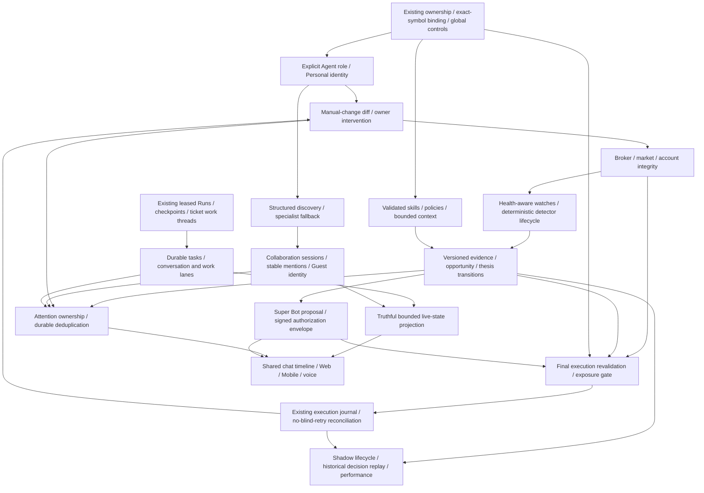

# Capability dependency graph

## Existing foundations retained

One Gateway/Worker host, ToolRegistry, ModelRouter, PostgreSQL event cursor, exact-symbol Agent binding, run leases/fencing, checkpoints, peer/subagent outcome receipts, market snapshots, watches/wake receipts, Cloud Charts, TradingGoals/GoalDecisionRow, TradingJournalRow and approval state.

## Ownership during wave 1

| Owner | Owned boundary | Shared hand-off |
| --- | --- | --- |
| Integration/root | Agent role/bootstrap/scope, schema/migration, durable approval anchor, inbox projection, docs and integration registration | Agent role, timeline_seq, inbox projection |
| Skills | Manifest/registry/resolver/context, immutable policies, packaged resources | Actual tool definitions; leased selection metadata |
| Chat reliability | Shared TS timeline, Web/Mobile chat/inbox/voice lifecycle | Backend timeline_seq/inbox; no invented state |
| Market health | One HealthSnapshot and deterministic assessors, existing watch/runtime health integration | Trading consumes same assessors |
| Task runtime | Existing tickets as logical tasks, separate work threads, checkpoint controls, reserved conversational capacity | Existing executor/ToolLoop hooks sequenced with skills owner |
| Execution | Existing preflight/executor/journal, account serialization, measured exposure/quality | HealthSnapshot, existing scope and controls |

## Integration waves

1. Explicit scope + selective skills + health gating + truthful task lanes + chronological chat + final execution gate. Independent ownership above; schema only root. Integrate and regress safety first.
2. Structured discovery + collaboration/Guest membership + stable mention IDs; manual broker diffs and reconciliation-first recovery; deterministic evidence/watch lifecycle.
3. Durable thesis/opportunity/decisions; shadow isolation/performance; attention ownership/dedup; account exposure and measured relationships.
4. Super Bot in-chat proposal + trusted single-use device authorization; bounded goal integration; Web/Mobile/voice shared live-state and explainability.
5. Recovery/replay/end-to-end and native device verification, matrix closeout and review.

Within each wave smaller vertical commits are integrated and tested. No competing scope, task, evidence or health contracts. ToolLoop changes are coordinated between skills and task owners; root owns migrations. No repository worktrees or production financial tests are needed.

## Conflicts resolved

- 05 broad visibility versus specialist immutable binding: explicit Personal identity, never wildcard symbol. Broad visibility is not an execution grant.
- 04 concurrent conversation versus one-run-per-thread fencing: reuse ticket work threads with same Agent, preserve claim fences, reserve conversational capacity.
- 02/18 timeline versus separate approval footer: durable sequence anchor plus one shared projection, same approval identity across updates.
- 03 autonomy versus approval/device rules: preparation cannot grant authority. No activation without trusted owner authorization; all financial controls remain below model.
- 03 monitoring versus 13/17 degraded data: health gate precedes confirmation and execution; recovery reconciles before resuming.
- 06 collaboration versus permissions: evidence can cross sessions, execution authority cannot.
