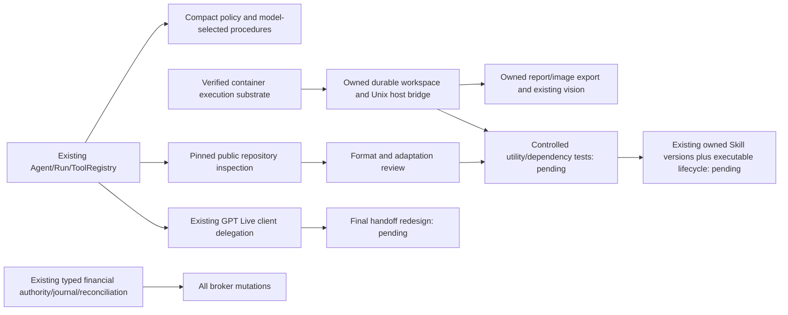
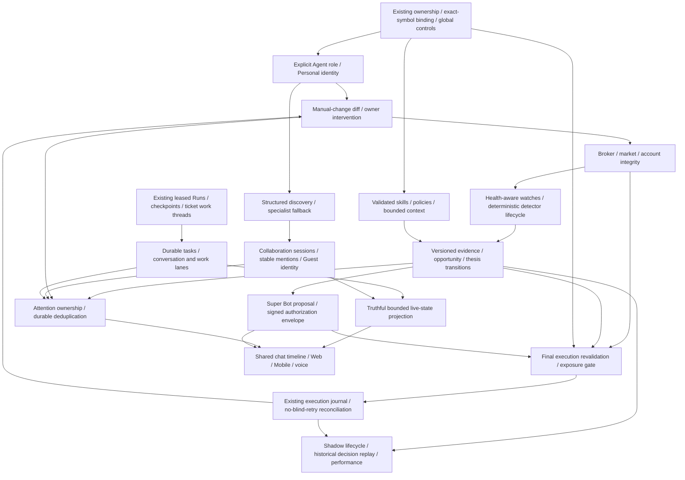
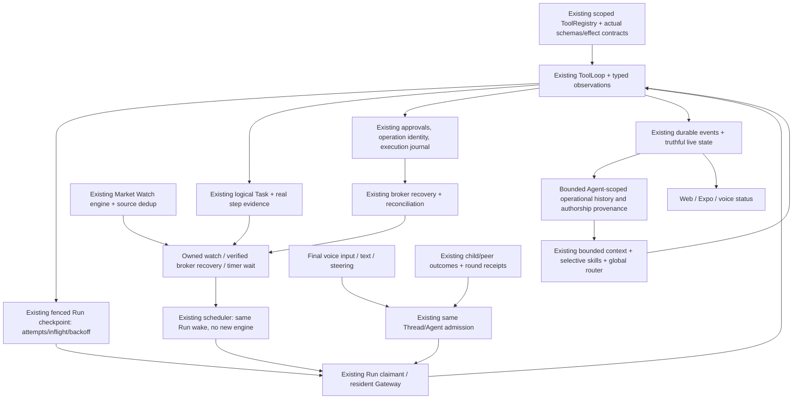

# Capability dependency graph

## Active agent-first mandate (2026-10-21)

Inspection has no installation or execution edge. Workspace outputs and imported
instructions remain analytical inputs; they never acquire broker credentials or
an alternate financial execution route. Current evidence is in PROGRESS.md and
the M-series matrix rows.

## Existing foundations retained

One Gateway/Worker host, ToolRegistry, ModelRouter, PostgreSQL event cursor, exact-symbol Agent binding, run leases/fencing, checkpoints, peer/subagent outcome receipts, market snapshots, watches/wake receipts, Cloud Charts, TradingGoals/GoalDecisionRow, TradingJournalRow and approval state.

## Ownership during wave 1

| Owner | Owned boundary | Shared hand-off |
| --- | --- | --- |
| Integration/root | Agent role/bootstrap/scope, schema/migration, durable approval anchor, inbox projection, docs and integration registration | Agent role, timeline_seq, inbox projection |
| Skills | Manifest/registry/resolver/context, immutable policies, packaged resources | Actual tool definitions; leased selection metadata |
| Chat reliability | Shared TS timeline, Web/Mobile chat/inbox/voice lifecycle | Backend timeline_seq/inbox; no invented state |
| Market health | One HealthSnapshot and deterministic assessors, existing watch/runtime health integration | Trading consumes same assessors |
| Task runtime | Existing tickets as logical tasks, separate work threads, checkpoint controls, reserved conversational capacity | Existing executor/ToolLoop hooks sequenced with skills owner |
| Execution | Existing preflight/executor/journal, account serialization, measured exposure/quality | HealthSnapshot, existing scope and controls |

## Integration waves

1. Explicit scope + selective skills + health gating + truthful task lanes + chronological chat + final execution gate. Independent ownership above; schema only root. Integrate and regress safety first.
2. Structured discovery + collaboration/Guest membership + stable mention IDs; manual broker diffs and reconciliation-first recovery; deterministic evidence/watch lifecycle.
3. Durable thesis/opportunity/decisions; shadow isolation/performance; attention ownership/dedup; account exposure and measured relationships.
4. Super Bot in-chat proposal + trusted single-use device authorization; bounded goal integration; Web/Mobile/voice shared live-state and explainability.
5. Recovery/replay/end-to-end and native device verification, matrix closeout and review.

Within each wave smaller vertical commits are integrated and tested. No competing scope, task, evidence or health contracts. ToolLoop changes are coordinated between skills and task owners; root owns migrations. No repository worktrees or production financial tests are needed.

## Conflicts resolved

- 05 broad visibility versus specialist immutable binding: explicit Personal identity, never wildcard symbol. Broad visibility is not an execution grant.
- 04 concurrent conversation versus one-run-per-thread fencing: reuse ticket work threads with same Agent, preserve claim fences, reserve conversational capacity.
- 02/18 timeline versus separate approval footer: durable sequence anchor plus one shared projection, same approval identity across updates.
- 03 autonomy versus approval/device rules: preparation cannot grant authority. No activation without trusted owner authorization; all financial controls remain below model.
- 03 monitoring versus 13/17 degraded data: health gate precedes confirmation and execution; recovery reconciles before resuming.
- 06 collaboration versus permissions: evidence can cross sessions, execution authority cannot.

## Integration checkpoint (2026-10-15)

Identity, skills, task lanes, canonical chat, health and final execution foundations are integrated. Collaboration/mentions, deterministic detector transitions and manual broker recovery now consume them. `ThreadRow.purpose` excludes internal work from the public inbox without a new conversation engine. Broker activity reads use existing durable events; returns use existing outcome receipts. Approval broker snapshots protect material owner changes, including SL/TP and volume.

Next shared contract is historical decision/evidence plus thesis identity, before shadow/performance, explanation replay, attention and Super Bot. These consumers must not each invent their own evidence or authorization records. Full acceptance of these later capabilities remains open.

Historical decision snapshots now reuse durable events and effect receipts. Typed broker evidence, health-gated actions and read/compare tools are connected to the same AgentRuntime. This is the evidence foundation of wave 3; thesis identity/expiry, financial-decision auto-capture, shadow/performance and attention still depend on it and remain open.

## Review safety dependencies

Source-time watch confirmation precedes any thesis/execution freshness gate. Explicit delegated identity is enforced below tools, approvals and execution, including Agent and Run ancestry. Collaboration is keyed by original request plus bounded round; one synthesis receipt/identity consumes actual delivered outcomes. Task outcome projection is derived from durable TaskState and cannot be independently edited by generic ticket APIs. These are shared preconditions for the remaining intelligence and authority work.

Opportunity/thesis state now consumes the shared decision ledger and source-time watches, exposes bounded history/context, and supplies a final entry gate to the existing executor. Same-Agent transition wakes reuse work threads, Run dispatch and outcome receipts. Shadow and performance work must reuse this identity/evidence/journal lineage and retain separate execution mode; they must not introduce another broker-mutation route.

Explicit Agent/Run execution mode now separates virtual execution before broker mutation. The same journal stores mode-tagged receipts; broker reconciliation and account-risk history select live operations only. Shared read-only preflight consumes real broker data plus virtual target state. Gateway market maintenance feeds virtual lifecycle; immutable decision/thesis references feed bounded performance summaries. These are prerequisites for Shadow goals and richer explainability/performance clients, not a second scheduler or live executor.

Task failure recovery now consumes server Tool classification, durable checkpoints and existing financial journal state before using the shared scheduler. Existing failed Run identity remains fixed across owner/automatic attempts; claim fencing advances. Failed-step metadata and bounded next-retry state feed the same Web/Mobile live projection. Attention can consume the durable retry/review transitions without converting every retry into a chat message. Unknown external mutations remain reconciliation-blocked.

Attention now consumes existing committed events, source-time setup evidence, Personal/specialist/host identity and Task recovery transitions. One durable owner projection supplies both clients; mandatory channels reuse existing delivery receipts. Super Bot activation and future execution-quality notifications must emit structured transitions into this same classifier, not create another notification service. The next independent intelligence work can consume existing broker candles and the historical evidence ledger for measured cross-market relationships.

Measured relationships now consume the same broker history/health and canonical bar-close semantics, persist derived evidence in the historical event ledger, and supply optional bounded references to decisions/theses. One eligibility predicate is reused by decisions, final thesis gates and Shadow entries. Future relationship change watches must reuse this calculator and current watch scheduler/receipts; they must not introduce another market monitor or hardcoded correlation matrix.

The existing dynamic detector tree and Watch engine now consume relationship calculations directly. Closed-bar evidence identity precedes confirmation count/debounce; source deadlines precede attention and thesis execution gating. Relevant change wakes use existing work Runs and receipts, and recovery never replays the original confirmation as a new signal. Future cluster-risk/advanced intelligence must consume these same measured sources and explicit unavailable states.

## Signed authority integration (2026-10-16)

Existing authenticated owner/session → registered WebAuthn public credential → immutable reviewed Goal permission envelope → expiring challenge bound to session/request/hash → verified UV signature → active Goal grant. The same Goal executor checks that grant on background execution and again before send. Supervised mode branches into the existing durable trade approval; advisory mode cannot mutate. Existing global Trading/Emergency controls, financial scope, fresh evidence, account serialization, fixed operation ID, journal and reconciliation stay downstream and authoritative.

Web/Expo cards consume the same request projection and `super_bot.updated` events; existing attention ownership/deduplication treats pending authorization as mandatory action. There is no new scheduler, executor, Agent class, voice Agent or model router. Native OS passkey bindings depend on the public installed-app signing certificate / Apple Team ID and a new compatible native binary; hardware acceptance remains separate from the passing WebAuthn browser tests.

Next shared dependency: expose bounded authority/Goal state through the existing live-state projection, finish Shadow Goal orchestration, and connect richer risk budgets/decision lineage to the same financial gate. Do not introduce a second authority, performance or Goal runtime.

## Activation review / live projection integration

Verified grant → existing scheduler + atomic effect receipt → one observe-only work Run → existing global Background route + normal ToolLoop → validated origin Goal read/account/market tools → durable Run result → existing outcome receipt → original conversation/group. Financial executor rejects observe-only authority, including descendants; the review does not resume blocked Goals. Grant/Goal/Run records derive the same bounded status for Web/Mobile/voice. Failed review state is inspectable and never becomes a repeated model timer.

## Frozen-mode Goal orchestration

Existing Agent + Run execution mode → shared frozen Goal scope validation → same Goal decisions/steps → existing approval or signed mode-bound authority → same Goal preflight/evidence/operation identity → existing journal. Only the explicit Shadow branch writes virtual state; the default financial executor remains live-only. Goal mode cannot change when Agent mode changes: current work pauses and grants stop. Legacy Goals without a mode remain live.

DB virtual-position/order projection serves both Market watches and Trading evidence without a Market→Trading package dependency. Broker prices/candles remain read-only evidence. Virtual targets, sampled fills and condition checks reuse the existing Gateway/watch/scheduler lanes; monetary profit remains explicitly unavailable. Atomic virtual state + journal precede Goal recovery; lease fencing precedes failure writes. Approval state reflects the actual result, including post-approval validation failure. No migration or second executor/scheduler/runtime is introduced.

## Automatic execution-boundary evidence

Existing typed preflight snapshot + exact request → existing execution-quality policy/gate → server-owned planned/before-send snapshots in the same execution journal → immutable receipt/reconciliation merge → bounded exact-scope read/history tools → natural-language historical explanations. Shadow captures virtual targets with monetary profit unavailable; local cancellation records its actual virtual target without inventing a broker snapshot. Broker reconciliation may add an outcome, never replace original server evidence. Performance attribution consumes the same frozen Agent/Run origin, with legacy Run lookup only when needed. No second decision journal or broker read is introduced for replay.

## S19 integrated operating environment (2026-10-18)

One owner defined Tool/Registry/ToolLoop/Run contracts. Independent chart projections and continuity/reference audits consumed them. No second scheduler, wait engine, event store, memory database, voice Agent or provider router was introduced. Tool-scoped replay safety is declared only for inspected receipt/idempotency paths; an interrupted unreceipted mutation becomes uncertainty, never an automatic resend. A model changing its call ID cannot erase a route's failed/ambiguous observation.

The current source matrix tracks all88 S19 sections. Backend/local acceptance and physical Android acceptance are separate; native building remains prohibited by the owner. Existing partial01–18 domain features retain their previous dependencies/status rather than being relabeled complete by this runtime extension.

## Professional Trading Agent Environment — Current Extension

Baseline `80b0ff9`, branch `feat/trading-agent-environment`. The original graph above remains a capability history, not a second implementation program. The approved [environment plan](NANOBOT_PARITY_AND_RELIABILITY_PLAN.md) extends the same owners.

First dependency: existing model messages/tool contracts → shared bounded context selection → global catalog/policy per routed attempt → provider output limit → request/usage diagnostics → actual fallback and runtime recovery acceptance. Shared context selection belongs below both AgentRuntime and providers; providers must not import AgentRuntime.

Next dependents: persisted result references → scoped evidence retrieval and Chart Use contracts; Skills versioning → evaluated learning; existing child outcome receipts → scoped visual workspaces and host synthesis; backend chart authority → TradingView renderer → on-demand visual sessions → truthful interaction. These remain planned until separately integrated and verified.
# Current typed chart integration boundary

Existing ChartState / scoped ToolContext / chart row version
→ typed bounded geometry and protected Agent/manual layers
→ persisted scene + saved SVG
→ shared Web/Mobile renderer and exact scene acknowledgment
→ on-demand server visual session / image observation (remaining)
→ evidence-backed Agent drawing verification (remaining).

These extend the existing chart runtime; no second chart database, gateway or trade executor is introduced. Client acknowledgments are presentation evidence and cannot authorize trading.

### On-demand visual capture dependency resolved (2026-10-19)

Shared licensed renderer → exact applied-scene acknowledgment → bounded server capture → immutable snapshot artifact → scoped image observation → global VISION/context admission is implemented and locally verified. Existing Gateway and owner lifecycle host the lazy browser; semantic and browser sources stay distinct. Persistent visual workspace/navigation and real external-model interpretation quality remain open. Durable chart command receipts are a separate next integration and must not be inferred from image replay safety.

### Compacted conversation evidence dependency resolved (2026-10-19)

Canonical owned direct conversation + summary/input/next-sequence boundaries → bounded lexical historical evidence → optional one authorized adjacent turn → existing memory fusion/context budget. Notes and messages share one output budget; peer/group/work content does not acquire direct-conversation authority. Cross-thread and semantic-message retrieval remain separate unimplemented scope.

### Native chart update recovery dependency resolved (2026-10-19)

Validated scoped native command + current fence → one chart mutation/EffectReceipt transaction → immutable configuration acknowledgment → inspect current scene separately. Same-call retries cannot reapply stale drawings over owner edits. Existing optimistic versions protect different commands. Creation-request identity (chart_open) remains a distinct next boundary.

### Retained Skills authority dependency repaired (2026-10-19)

Pinned instructions + current selected-Skill eligibility → new-effect/model admission. Checkpoint restore no longer bypasses current disable/source/removal controls merely because no steering occurred. Shared resolver eligibility and current Run fences remain authoritative; completed receipts and known same-operation reconciliation retain existing priority. Per-version revocation and evaluated adoption are still separate missing capabilities.

### Chart creation/read dependency resolved (2026-10-19)

Native original creation intent → atomic configuration/receipt → explicit current read → existing initializing-scene runtime lease → current candles/indicators/snapshot. Creation and update replay never substitute today's scene for the original acknowledgment. Immediate open→snapshot works without a browser or a test-side refresh. Ready scenes, real source failures and immutable artifact replay retain their separate semantics. Persistent visual workspace/navigation remains open.

### Exact Skill-version denial dependency resolved (2026-10-19)

Authenticated owner/Agent → typed bounded settings + optimistic revision/durable event → effective pinned-version resolver rejection → actual loaded-instruction checkpoint binding → existing runtime boundary denial. Installed resource deletion or source relabel cannot erase a version control. New unrevoked versions remain available to new Runs; prior Runs never upgrade silently. Candidate evaluation/adoption/rollback must consume this same control and must not create another registry.

### Progressive Skill access dependency integrated (2026-10-19)

Canonical ToolRegistry → injected Agent-owned catalog access → effective pinned resolver/controls → bounded dependency bundle + fenced receipt → verified tool-result/authority checkpoint → subsequent effect/model admission. Steering consumes retained views through the same resolver and budgets. This is one instruction lifecycle, not another registry, permission layer or memory system. Evaluated candidate/adoption/rollback remains downstream and unimplemented.

### Broker discovery cancellation boundary (2026-10-19)

Existing MetaApi transport hook → shared shielded discovery task + bounded failure/cooldown → official SDK host cache → account-derived region → independent stream/history consumers → durable market snapshots → chart/watch evidence. Shutdown owns the shared task. Financial execution/reconciliation remains a separate existing path with no blind retry.

## Owner Skills management hand-off — 2026-10-20

Existing manifest/installed registry → shared resolver and current exact-version controls → owner-scoped current metadata catalog → lazy procedural detail → Web Knowledge/Skills and Mobile Agent settings. Current catalog observations do not replace pinned Run snapshots. Confirmed owner version denials feed the same runtime boundary checks; CRUD uses the same resource revision/graph validation. Evaluated candidates/adoption/rollback remain downstream, not a second permission or learning system.

Next Chart Use dependency was audited read-only against actual tools/visual runtime/renderer: structured Agent viewport intent and actual renderer range acknowledgment are missing. User viewport remains local; future Run/Task-scoped Agent view state can reuse server-owned metadata, fences and effect receipts before view-specific captures. One-shot visual capture, Follow/Free Browse and current scene history are existing foundations. Historical paging, persistent sessions and coordinate interactions remain separate unimplemented acceptance requirements.

## Integrated shared capability wave — 2026-10-23

Pinned source inspection -> bounded disabled Skill package -> existing owned
workspace -> immutable reviewed dependency image -> real utility receipt ->
current-version activation/rollback/revocation -> existing Run instruction pinning.
No imported source can modify financial authority or install runtime dependencies.

Existing broker history/specification -> typed scenario research -> chronological
validation/OOS/robustness -> immutable report artifact -> same Agent's historical
context. Existing detector+health -> independent opinion/entry/execution projection.
Neither report nor projection is execution permission.

Existing verified device assertion -> immutable account envelope -> existing
account-serialized executor -> final snapshot/owner-change/scope/limits -> existing
journal/reconciliation. The same signed scope feeds existing live state/avatar
presentation and Web/Mobile settings. Monetary loss sizing depends on verified
contract/tick/currency metadata and remains unavailable.

Existing attention -> consent/device/quiet-hours/rate -> durable invitation ->
foreground accept/reject -> same Agent/Thread GPT Live. Native push and PSTN need
real provider/native integration and independent delivery acceptance. Bounded Live
transcript revisions -> same-work steering -> provisional provenance -> financial
confirmation boundary. Audio offsets cannot manufacture semantic finality.
