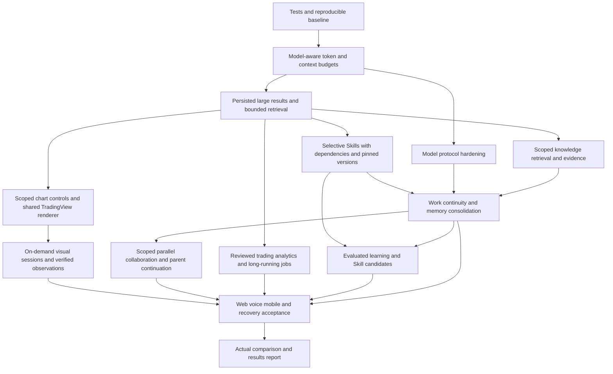

# Lonora Professional Trading Agent Environment Build Plan

Status: implementation in progress on `feat/trading-agent-environment` from `80b0ff9`. The first context-admission capability has local verification; this does not establish completion of Wave 0/1 or the program. Build and acceptance requirements updated: 2026-10-18. See BUILD_CAPABILITY_CARDS.md, IMPLEMENTATION_MATRIX.md, and PROGRESS.md for evidence and remaining work.

Recorded Lonora baseline: `80b0ff9`, deployed to production at the time of this plan. Recheck repository and deployment revisions before implementation. The filename is retained for existing links; the plan now draws selectively from Hermes Agent, gbrain, Rakazo, and Nanobot.

This is an implementation supplement to specifications 01 and 19. It reuses the task, collaboration, and voice foundations in 04, 06, and 15. It does not replace the original requirements or their acceptance matrix. The source review is documented in [NANOBOT_ARCHITECTURE_STUDY.md](NANOBOT_ARCHITECTURE_STUDY.md).

## Product Mandate — A Professional Trading Agent

Lonora is a persistent trading Agent product with institutional-grade quality goals. Its intelligence, knowledge, collaboration, and execution capabilities serve market research, evidence-based analysis, continuous monitoring, account and portfolio understanding, trading goals, controlled execution, and position management.

The product Agent does not generate application code, expose a general-purpose terminal, execute model-authored scripts, or modify production software. Engineering teams may implement and test analytical tools; the Agent invokes their reviewed contracts. Improving a Skill means improving trading procedures, analysis methods, and evidence requirements under evaluation, not granting code execution or self-deployment.

Simple architecture means clear ownership, explicit contracts, and maintainable implementation. It does not mean shallow analysis, limited trading capability, or weaker reliability. The owner's company-scale ambition is translated into measurable correctness, operational resilience, security, risk control, execution quality, and product experience; company valuation is not an engineering acceptance metric.

## Reference Selection and Evidence

Select implementations by demonstrated behavior, clarity, testability, and fit with Lonora. Similar feature names do not establish equivalent behavior or code quality. Do not declare one repository universally cleaner without a scoped audit.

| Reference | Evidence available for this plan | Useful patterns | Lonora integration target |
| --- | --- | --- | --- |
| [Hermes Agent](https://github.com/NousResearch/hermes-agent/tree/22063fc099ec9ad8357d7f8f6e6248a0400680d3) | Selected Python implementations inspected at `22063fc099ec9ad8357d7f8f6e6248a0400680d3`; upstream tests not run | Scoped child execution, parallel delegation and cancellation, tracked background processes, progressive Skills, session recall, post-task learning, observation tools and MCP lifecycle | Existing collaboration, Task/Run, tools/adapters, Skills, memory, and Gateway |
| [gbrain](https://github.com/garrytan/gbrain/tree/c8354664675a3a5e573959db1201c80b94a3d37b) | Selected TypeScript implementations inspected at `c8354664675a3a5e573959db1201c80b94a3d37b`; upstream tests not run | Hybrid retrieval, bounded evidence assembly, knowledge provenance/history, candidate Skill evaluation and independent held-out checks | Existing memory, evidence/result contracts, Skills lifecycle, and evaluation suite |
| [Rakazo](https://github.com/elie222/rakazo) | Existing project reference; pin the selected revision and record relevant source paths in Wave 0 before relying on its current behavior | Agent-centered chat, durable message/run flow, steering, collaboration presentation, progressive panels and overlays | Existing AgentRuntime/Gateway, API/events, Web/Mobile timeline and voice surface |
| [Nanobot](https://github.com/HKUDS/nanobot/tree/faf1efaf09d2d69d1887b6ac6b0c6441e3ccccb2) | Pinned source audit linked above; no claim of an executed upstream benchmark | Direct tool-feedback loop, context budgeting, result offloading, selective loading, bounded protocol repair | Existing ToolLoop, context governance, persisted results, and Skills |

Kili remains the separate broker/market/trading implementation reference from the original specifications. Adding these four general Agent references does not replace that work.

For each overlapping capability, record the candidates considered, actual failure/recovery behavior, dependencies, maintenance burden, chosen pattern, and reason for rejecting alternatives. Adapt the smallest useful pattern to Lonora's existing owner. Reference repositories remain read-only outside Lonora. Preserve required attribution if source is reused; a language port is still source reuse when substantially derived.

Source-reading anchors include Hermes `tools/delegate_tool*.py`, `tools/terminal_tool_background.py`, `tools/skills_tool.py`, `tools/session_search_tool.py`, and `agent/background_review.py`; gbrain `src/core/search/hybrid.ts`, `search/evidence-delivery.ts`, `belief/append.ts`, and `skillopt/{validate-gate,held-out,version-store}.ts`. These anchors guide inspection rather than prescribe Lonora's file layout.

## Simplicity, Code Organization, and Product Experience

The owner's system illustration expresses understandable responsibilities and flows. It is not a prescribed process topology or a claim of perfect results. Simplicity applies both to code and to the user's experience; server-side financial and ownership boundaries remain enforced.

[Permanent owner-supplied visual reference](assets/lonora-organized-system-reference.jpg).

**Standing owner requirement, reaffirmed 2026-10-18:** deliver the well-organized Lonora system represented by the supplied illustration. This requirement persists across implementation waves and session handoffs; the owner must not be asked to resend it. Capability breadth does not excuse fragmented ownership, duplicated systems, tangled dependencies, confusing permissions/delegation, or inconsistent user journeys.

At every integration point, review both behavioral correctness and organizational quality: one implementation owner per capability; explicit dependencies and authoritative state; cohesive files and understandable request paths; reuse before new infrastructure; and consistent, natural user interaction. A feature that works in isolation but violates these conditions is not ready for integration. Record violations and their resolution in the existing progress/matrix records instead of treating them as optional later cleanup.

### Professional Trading Depth and Release Gates

The original trading specifications remain delivery obligations, not optional examples. Extend their current capability owners and acceptance matrix to demonstrate:

- **Market truth:** exact instrument identity and contract specifications, supported timeframes, live quotes/candles, synchronization health, freshness and gaps, consistent server-side indicators, and continuously maintained chart state.
- **Decision quality:** timestamped evidence, multi-timeframe context, thesis/invalidation conditions, account exposure and execution constraints, explicit uncertainty, and WAIT when evidence or authority is insufficient. A polished explanation does not establish a valid decision.
- **Persistent goal management:** observe, wake, rebuild current context, revalidate conditions, decide, execute when authorized, verify, update progress, manage positions, and schedule the next condition. Owner intervention, pause, cancellation, and recovery remain authoritative.
- **Financial execution:** all supported market/pending/modify/cancel/close paths, manually opened positions, account-wide conflicting-mutation serialization, risk limits, approvals, operation identity, journal, actual broker outcome, and reconciliation before any ambiguous retry.
- **Operational resilience:** defined recovery behavior for stale data, broker loss, provider failure, database interruption, lease takeover, and event replay, with useful diagnostics and auditable historical evidence.
- **Measured strategy evaluation:** distinguish real, demo, shadow, and historical outcomes; include fees, spread/slippage assumptions, data limitations, and out-of-sample checks where applicable. Do not promote a procedure from a favorable isolated trade or historical fit.
- **Scale and service quality:** define and measure concurrency, per-owner fairness, throughput, latency, chart/event freshness, availability, recovery objectives, and cost budgets under a declared workload. Set numerical targets in capability cards from measured baselines before release; do not invent capacity guarantees.
- **Product reliability:** the same task, account, approvals, evidence, and outcomes across Web, Mobile, and voice, verified through realistic trading journeys and failure recovery.

Automated financial testing uses simulation/scripted brokers and replay. Demo-broker verification is reported separately; live-money automated tests are prohibited. Passing generic Agent benchmarks alone does not satisfy these trading release gates.

### R01 — One Capability, One Implementation Owner

Use the existing package structure. Document actual imports and callers before moving code. The responsibility map below guides changes; it does not require every request to traverse every package.

| Existing area | Responsibility boundary |
| --- | --- |
| `apps/api` | Authentication-bound request validation and transport; call existing application/domain services |
| `apps/worker`, `packages/gateway` | Process hosting, dispatch, lifecycle, durable wakes, and long-lived connections |
| `packages/agent-runtime` | Context, model/tool loop, task continuity, Skills use, and collaboration orchestration |
| `packages/contracts`, `core`, `db`, `session` | Shared public shapes, core rules, durable persistence/transactions, and existing session/effect identity |
| `packages/tools`, `adapters`, `adapter-kit`, `providers` | Model-facing tool surface, external integration boundaries, and provider protocols |
| `packages/memory` | Scoped knowledge storage/retrieval and consolidation using existing persistence |
| `packages/market`, `charts`, `trading` | Authoritative market/chart state and the controlled financial execution path |
| `packages/auth`, `security` | Existing identity and authorization primitives reused at enforcement boundaries |
| `apps/web`, `apps/mobile`, shared UI packages | Rendering, interaction, localization, and recovery from authoritative server state |

Keep transport handlers thin and business rules in their current domain owners. Do not introduce a generic wrapper for every function, deep inheritance for tools, or one file per trivial forwarding operation. Split modules when they contain distinct responsibilities or make testing/navigation difficult, with cohesive names and a clear public entry point. Do not optimize for an arbitrary file-count or line-count target.

Acceptance: a maintainer can trace a representative request and find the single owner of each decision. Changed paths introduce no circular imports, competing registries, duplicate state machines, or new cross-layer shortcuts. Remove replaced branches and update callers/tests together; do not leave both implementations active.

### R02 — Simple Authorization and Delegation

Reuse current ownership, scope, tool metadata, and trading controls. Resolve an effective execution scope from authenticated ownership, Agent binding, Task context, existing grants, and global controls. Tools consume the same server-enforced result instead of inventing independent permission systems. Recheck current authoritative controls immediately before sensitive effects; a frozen context does not freeze a revoked grant.

- Ordinary permitted reads, analysis, and internal delegation run without repeated user confirmations.
- User-facing approval appears only when required by policy or genuinely missing authority. Show the specific action and consequence in one consistent approve/reject interaction.
- A child receives a bounded goal, relevant context, allowed tools, deadlines, budget, and result contract. Child access cannot exceed the parent or violate its own account/symbol binding.
- Temporary research children remain internal task participants, distinct from persistent user-created Bots. Do not make users configure an Agent hierarchy to complete a normal request.
- Keep existing observe-only delegation restrictions. Any future child mutation requires a separately reviewed contract through the same authoritative effect path; do not silently broaden permissions during this work.
- Global model routing remains global. Parallel child work does not create per-Agent provider/model settings.

Acceptance: normal authorized work proceeds without redundant prompts; wrong-owner access and authority escalation are denied; revocation and Emergency Stop take effect during active work. Approval receipt/replay behavior remains correct after reconnect or restart.

### R03 — Reviewed Trading Analytics and Execution Environment

Audit existing market, chart, account, risk, calculation, research, simulation, and reporting tools first. Reuse them where sufficient. Add reviewed domain tools for demonstrated gaps such as multi-timeframe analysis, instrument-aware calculations, scenario comparison, historical replay, and verification. The Agent supplies validated parameters; it does not author or run arbitrary code.

Inputs/outputs are owner/Task-scoped evidence and artifacts. Analytical jobs have bounded resources, duration, output size, and data access. Tool availability is based on reviewed capabilities. Production credentials and infrastructure controls are not model-facing tools. Financial mutations remain available only through the existing trading tools and journal.

Track long analytical and trading-goal operations through current Tasks/Run checkpoints and lifecycle ownership: start identity, running/waiting state, evidence reference, actual result, cancellation, and cleanup. A running job is not success. Reconcile interrupted work before deciding whether continuation is safe. Do not create a second scheduler or rely on an untracked daemon thread for durable work.

Acceptance: a real market-analysis workflow using reviewed tools, reproducible calculations, bounded evidence retrieval, quota enforcement, cross-owner denial, cancellation, restart recovery, and cleanup. No general shell, model-authored code execution, or cloud-desktop surface is part of this capability.

### R04 — Practical Collaboration and Parallel Work

Extend existing subagent, peer, group, outcome-return, and steering paths after checking their current behavior. Independent research or calculations may run in parallel; work that changes a shared contract or conflicting resource is sequenced. Collaboration is optional and proportional to expected benefit.

Each child has identity, parent/Task linkage, scope, budget/deadline, observable status, and a bounded result with references and limitations. Parent continuation consumes each durable outcome once; child timeout, cancellation, partial result, and failure are distinct. Handle late results and parent cancellation without orphan work or stale synthesis. Keep the parent responsible for integrating and verifying outcomes.

Acceptance: parallel success, one-child failure, timeout, steering, cancellation during spawn, duplicate/late delivery, and parent/worker restart. User-facing progress reflects persisted work rather than synthetic activity.

### R05 — Knowledge and Learning Integrated Once

Extend current lexical/semantic retrieval with evaluated hybrid ranking and bounded evidence assembly where it improves measured recall. Apply access scope before retrieval, ranking, cache reuse, and expansion. Exact broker symbols and IDs remain exact; evaluate Arabic/English retrieval and technical identifiers separately.

Preserve primary sources, owner facts, tool observations, generated summaries, and inferences as distinguishable evidence. Track corrections, contradictions, observation time, and validity where needed. Reuse current versions/events first; introduce focused queryable fields only for demonstrated needs. Do not copy gbrain's entire schema or assume a generated summary is authoritative.

Search original authorized conversations for supporting detail when compressed memory is insufficient. Distinguish no matching evidence from a failed retrieval source. A missing embedding provider may allow explicit lexical fallback, but must not fabricate semantic coverage. Historical knowledge never substitutes for current broker state or fresh execution evidence.

After meaningful work, schedule a bounded, deduplicated review through existing automation only when useful evidence or feedback exists. It may propose sourced memory corrections or Skill/Playbook candidates. Do not run an LLM on every tick or require a review after every trivial message. Candidates pass the versioned evaluation and adoption policy in B06/B07, including independent cases beyond their optimization set. Do not copy direct background writes or filesystem-only durability from a reference where Lonora needs durable, controlled publication.

Acceptance: multilingual recall, source context, conflicting/stale evidence, deletion/invalidation, scope-safe cache behavior, failed retrieval, restart-safe review, and a candidate rejected for regression. Learning cannot alter authority or retain private reasoning.

### R06 — Intelligent, Smooth, and Truthful Interaction

Keep Agent-centered, chat-first interaction across text, voice, Web, and Mobile. The user states an outcome naturally; Lonora selects tools, Skills, and delegation without making the user learn internal names, fixed commands, permission tiers, or worker topology.

- Simple requests get direct execution; complex work gets a concise plan only when useful.
- Show one coherent activity surface with real stages, waits, blockers, and outcomes. Expand technical details, child activity, sources, and errors on demand.
- Reuse existing Task/Run/attention/live-state projections. Do not add a separate UI-only workflow or turn every internal event into a chat message.
- Use panels/overlays for charts, files, evidence, and approvals when appropriate, preserving the conversation and active call across navigation.
- Use the same approval identity and status in chat cards and call controls. Prevent repeat submission; show pending, executing, rejected, confirmed, ambiguous, or failed behavior according to existing authoritative contracts.
- On reconnect/reload, rebuild from durable state without duplicate answers, lost active work, or misleading authentication/content flashes. Keep input, scrolling, navigation, and accessibility responsive.
- Human-facing text uses localization keys with Arabic and RTL support. Symbols, IDs, prices, and URLs remain readable. Expose stable error codes and parameters through existing contracts, not inconsistent hardcoded messages.
- Summaries explain actions and evidence, not hidden chain of thought. Ask for clarification only when the missing information affects the outcome or authority and cannot be inferred safely.

Acceptance: representative direct, long-running, delegated, approval, failure, reconnect, cancellation, voice/text, and artifact journeys. Test Web and Mobile semantic parity; report physical-device and real-voice acceptance separately. No APK build/publish is implied by a documentation update.

### R07 — Code Quality as an Integration Gate

Every capability card records the simplest viable change, affected owners/public interfaces, reference pattern selected, and any complexity introduced or removed. A new abstraction needs multiple real consumers or a demonstrated isolation/testing need. Prefer explicit composition and direct calls over hidden auto-registration, dynamic import tricks, or generic policy DSLs without a concrete requirement.

Review each integrated wave for duplicate broker reads, retrieval pipelines, permission decisions, retries, result serializers, wake mechanisms, event projections, and Web/Mobile business logic. Consolidate actual duplication without merging genuinely different responsibilities. Keep transactions short; avoid model/network calls inside long database locks. Bound queues/concurrency and make failures diagnosable without secrets.

Run relevant existing tests, lint, types, and builds. Add behavioral tests for changed contracts, authority boundaries, effects, recovery, and user journeys. Document the request path, public contracts, and operational failure modes concisely. Do not add boilerplate tests or arbitrary complexity scores as substitutes for review.

Acceptance: the wave has one integrated implementation per capability, passing relevant checks, explicit remaining external blockers, and a reviewable migration/rollout path. Readability and tested behavior are reviewed together; neither feature count nor resemblance to a reference establishes quality.

## Live Chart Drawing and Presentation — Lonora-Owned Workflow

The owner confirms a TradingView license and authorizes using the library available in AiChart. AiChart is a visual reference only: do not import its Agent workflow, persistence, data authority, navigation model, or drawing timing as product requirements.

Selected visual reference: [loorksy/AiChart at 1a1b5e02914d8c43ae8c18a06b6c9d6cdc9ef1c8](https://github.com/loorksy/AiChart/tree/1a1b5e02914d8c43ae8c18a06b6c9d6cdc9ef1c8). Source inspection covered `SmartChartWorkspace.tsx`, `SheetCoordinator.tsx`, `useSheetGesture.ts`, `chart/TvChart.tsx`, and serialized drawing types. This is source inspection, not device acceptance. Lonora already has persisted chart state, chart tools, and validation for horizontal levels, trend lines, and notes; extend those owners rather than installing another chart system.

### C01 — One TradingView Renderer and One Backend Chart Authority

Use the licensed TradingView Charting Library for rendering, backed by Lonora's existing chart identity, market runtime, scene contracts, and broker-neutral data path. Keep a single maintainable integration entry point and shared asset distribution rather than duplicate library trees for Web and Mobile. Pin the library version and inventory runtime assets; preserve vendor files/notices and use license-permitted storage/distribution.

Implement the renderer's history/subscription datafeed against existing Lonora APIs/events. History and live updates must use the same owned account, exact broker symbol, supported timeframe, timestamps, and OHLC contract. Correctly replace an updated current bar, append a new bar, handle corrections/gaps, and rebuild after reconnect without inventing candles. TradingView is not the market source of truth.

Server-calculated indicators and evidence remain authoritative for Agent decisions. A client-only study or drawing is not fresh trading evidence merely because the library displays it. All charts and watches continue server-side when the sheet is hidden or the client disconnects.

### C02 — Durable, Typed Drawing Commands

Extend the existing annotation schema/tool surface rather than introducing competing drawing tools. Implement the supported set incrementally: existing levels/trend lines/notes first, then price zones, rays, channels, Fibonacci, arrows, and entry/stop/target scenario overlays where justified by trading workflows.

Store stable drawing IDs, author/source attribution, exact symbol/account/chart scope, applicable timeframe visibility, time/price anchors, bounded style/label fields, and version information. The backend validates each supported type and operation. Do not persist raw vendor internals, executable drawing instructions, or pixel positions as authoritative geometry.

Add/update/delete operations carry stable mutation identity and expected structural version using existing transaction conventions. Apply a coherent analysis batch atomically, or expose explicitly incomplete progress; do not present partial drawings as completed analysis. Handle conflicts without replacing newer user edits. User and Agent layers remain distinguishable, and a refresh never silently deletes manual drawings. Ordinary authorized drawing edits do not require financial approvals.

### C03 — When Drawings Appear and How They Are Verified

Natural text or voice request → inspect current chart/account/scope → read relevant fresh market evidence → select or compute analysis → submit validated drawing changes → persist accepted changes → publish chart update → renderer applies the saved revision → verify the outcome available to the system → report the result and limitations.

Drawings appear after the server accepts their saved changes, without waiting for final chat prose. If analytical work is still ongoing, expose its real status. A drawing command alone does not prove it was rendered. Distinguish saved, delivered, rendered where client evidence exists, and failed. Retry safe renderer application by drawing identity; do not regenerate the analysis or duplicate drawings to fix a rendering failure.

Use current chart tools to inspect persisted geometry and scene state. When visual inspection is necessary, use an available reviewed observation tool and identify the inspected scene/drawing revision. Snapshot metadata must identify its market-data time and chart revision; a static image is not a live chart. Closing the sheet does not interrupt analysis, and reopening reconstructs the latest saved state.

Scenario overlays remain analytical illustrations. Moving an entry/stop/target drawing does not submit or modify a broker order; actual execution always uses the existing trading tool, authorization, risk, approval, and journal path.

### C04 — Lightweight Bottom Sheet and Smooth Chart Browsing

Open the chart from its existing chat action or a linked chart artifact into a clean bottom sheet. Support a useful resting height, drag-to-expand, full-screen inspection, drag-to-collapse/dismiss, and an explicit accessible close control. On wide screens allow the chart beside the conversation. Product behavior follows Lonora navigation and active-call ownership.

Keep chrome minimal: exact symbol, timeframe, truthful feed status, and expansion controls; reveal indicators, drawing layers, and advanced tools on demand. Honor safe areas, visual viewport changes, keyboard appearance, orientation, reduced motion, accessibility focus, and back/Escape dismissal. Coordinate overlays so the chart, symbol picker, and other sheets do not create conflicting backdrops or dismiss the wrong surface.

Keep local viewport state separate from durable analysis state. New ticks, Agent drawings, and background analysis do not reset the user's zoom, pan, selected drawing, or historical location. Provide explicit follow-live and show-Agent-analysis actions. Do not write every gesture to PostgreSQL or remount the widget on every quote.

An explicit request to open/show the chart may reveal it. Background updates do not steal focus, expand a minimized sheet, or interrupt another section. Preserve the active call and conversation when expanding or hiding the chart. Specialist Agents retain their exact-symbol binding; a renderer picker cannot bypass it. Personal-Agent chart selection follows existing owned-account scope.

Reuse the renderer/datafeed/drawing semantics across Web and the Mobile integration selected after auditing the current application. Native sheet lifecycle and gestures must be tested on-device; a Web sheet inside a mobile viewport is not proof of native behavior.

### C05 — English and Arabic Vendor Assets Only

Expose English and Arabic chart locales synchronized with Lonora's application preference. Use localized Lonora labels and stable error codes; preserve readable left-to-right technical symbols, prices, timestamps, and IDs within Arabic UI. Locale changes preserve chart identity, saved drawings, indicators, and usable viewport state.

Audit the selected vendor build's actual dynamic dependencies before trimming language bundles. Retain English/Arabic bundles and all required shared scripts, CSS, fonts, images, workers, bootstrap files, and fallback resources. Exclude other locale-specific assets from Lonora's delivered build only after proving they are not required by the configured locales. Avoid copying both source-vendor and public copies from AiChart. Keep a reproducible asset manifest with hashes and verify requested chunks have no 404s in cold-cache tests.

### C06 — Delivery Dependencies and Acceptance

Audit/pin library and current chart contracts in Wave 0; extend typed geometry/evidence contracts alongside Wave 2; integrate Agent drawing tools and collaboration attribution with Waves 3–5; implement the renderer and sheet against those agreed contracts in parallel when safe. Run chart tests with each increment, with final device/recovery acceptance in Wave 6. This is not permission to defer backend verification until UI work is complete.

Acceptance covers: current supported symbol/timeframe classes and suffixes; history plus live bar updates; existing and new drawing types; Agent/user conflict and duplicate commands; persistence across browser close and server restart; reconnect/gap recovery; pan/zoom preservation; explicit reveal versus background updates; text/voice drawing; snapshots versus live scene; approval isolation; Arabic/English cold loads; asset loading; sheet/back/keyboard/orientation behavior; and Web/Mobile contract parity. Performance targets for cold-open, input responsiveness, live-update lag, and memory are measured on declared devices and workloads and set before release, not asserted as zero latency.

### C07 — Chart Use as a Core Capability of Every Trading Bot

Chart Use is a standard capability of every trading Bot, not a separate Agent class or a feature unlocked only by Super Bot. It combines structured market/scene inspection, precise chart control, and visual observation when useful. Discover and extend the existing tool contracts rather than defining a parallel chart-tool registry.

| Participant | Chart Use scope | Persistent ownership |
| --- | --- | --- |
| Exact-symbol specialist | Its bound broker instrument and authorized account, across supported timeframes | Agent-associated chart state, drawings, indicators, and analytical references |
| Personal Agent | Instruments within its authorized owned-account visibility | Explicit account/symbol/chart selection; no implicit cross-account merging |
| Temporary Subagent | The parent's delegated research scope, additionally restricted by the child's own applicable binding and tools | Task-linked analysis workspace, attributed evidence and drawing proposals; no new persistent user Bot required |
| Peer or group participant | Its own authorized scope and the collaboration's explicit grants | Attributed contributions linked to the existing collaboration and host chart |

Reuse existing chart rows and Agent/Thread/Task links to resolve or create a chart when first needed. Do not eagerly provision a browser per Bot or force a one-chart-per-conversation restriction copied from AiChart. Different timeframes and analysis views retain an explicit relationship to the correct account, symbol, and Bot. Shared authorized market-data connections/caches do not imply shared memory, drawings, or authority.

### C08 — On-Demand Visual Sessions, Not a Permanent Desktop

Provide a server-hosted chart observation session using the same licensed TradingView renderer, Lonora datafeed, typed drawings, and saved revisions as the user-facing chart. Browser OFF does not prevent Agent analysis or visual inspection. The Market/Cloud Chart Runtime stays active independently of these disposable renderer sessions.

Lease visual sessions from a bounded pool under the existing worker/Gateway lifecycle. Track owner, Agent, Task, chart, session identity, active generation, expiry, and cleanup through existing durable mechanisms where suitable. A session attaches to current chart state; renderer loss does not erase analysis or restart a financial operation. Recover by rehydrating saved state and starting a new session generation, rejecting stale observations or control results from an obsolete session.

Set concurrency, queueing, idle timeout, memory, rendering, and observation-call budgets per workload and owner. Close idle sessions and clean up on cancellation, Bot removal, lease loss, or shutdown. Do not allocate a continuously running browser for every Bot, capture every tick, or invoke the model for every price update. A resource limit produces an explicit wait or unavailable observation rather than a fake successful inspection.

Use a narrowly scoped chart route and short-lived server-validated access. The browser cannot navigate arbitrary sites, open production administration, access unrelated files/credentials, or bypass chart/account authorization. The product remains a trading Agent with a reviewed observation environment, not a general Computer Use or coding product.

### C09 — Structured Controls Plus Bounded Visual Interaction

Prefer precise domain controls for reading the scene, selecting supported timeframes, reading indicator state, listing/selecting drawings, changing a visible time/price range, focusing a region, fitting analysis, and adding/updating/removing typed geometry. Extend current chart tools only for missing behavior, preserving exact-symbol and account restrictions.

Use chart-local Computer Use interactions, such as click, drag, scroll, and selection, only when a demonstrated renderer interaction cannot be expressed adequately by an existing domain control. Bind coordinates to an identified screenshot, viewport, and session generation; reject or recapture when layout changes invalidate them. Such interactions cannot bypass validation or submit financial effects. User-visible drawings become authoritative only through the same validated backend mutation path, including when created through renderer interaction.

Expose two complementary observations: a bounded structured scene description and an actual screenshot when visual judgment is needed. The former supplies exact geometry, bar times, indicator values, layer ownership, and visibility; the latter exposes overlap, clipping, readability, and composition. A structured description is not a claim that the model saw pixels, and screenshot interpretation is not a substitute for exact market data.

### C10 — Intelligent Drawing Decisions and an Observe–Act–Verify Loop

Draw when explicitly requested, when a trading scenario benefits from visual explanation, or when a meaningful thesis/market transition requires updating an existing analysis. Simple account questions do not automatically trigger drawing or open the chart. Background reviews assess existing drawings for relevance without continually replacing them on every tick.

For each proposed analytical object, retain a bounded record of its purpose, supporting evidence references, account/symbol/timeframe, time/price anchors, analytical validity/invalidation conditions, and source attribution where relevant. This is an auditable analytical record, not private chain of thought. Keep the chart readable: update a relevant object instead of duplicating it; distinguish active, historical, and invalidated analysis without deleting the user's work.

The working loop is: understand the trading request → inspect authorized data and existing scene → choose whether drawing is useful → prepare evidence-backed geometry → persist validated changes → observe the applied scene → inspect visually when necessary → correct within a bounded budget → deliver the supported result or explicit limitation.

Visual feedback identifies the screenshot/session, applied drawing revision, actual observed data time, and relevant viewport. Live ticks continue during inspection; do not require an impossible match to a perpetually changing latest frame. Recheck freshness of decision-relevant evidence before a new market conclusion or any trading preflight. If visual verification is unavailable, report the saved state accurately without claiming visual confirmation.

### C11 — Watching the Agent Without Losing User Control

Publish actual chart-action events through the existing event/live-state infrastructure: target object or region, accepted/applied revision where known, progress/outcome, and attributed actor. Render highlights, a focus marker, or brief drawing transitions only from these actions. An animated pointer is a presentation of a real action, not fabricated work or proof that a mouse was used. Restore durable final geometry after reconnect; do not replay obsolete motion as new activity.

Offer explicit **Follow Agent** and **Free Browse** modes using localized labels. In Follow Agent, accepted viewport/focus actions guide the view. Direct user pan/zoom or drawing interaction yields to Free Browse; the Agent can continue analysis without taking the viewport back. Provide an explicit action to jump to the Agent's current analysis and distinguish it from following the latest market price.

An explicit open/show request reveals the sheet. An interactive analysis may reveal it when the user is following that conversation and current navigation/overlay state permits it; otherwise provide an open/show-analysis action. Background wakes and child activity do not expand a hidden sheet or interrupt another screen. Minimizing the sheet preserves the active call, Task, drawings, and monitoring.

Parallel Subagents use independent Task-scoped views or bounded virtual workspaces as needed. They return attributed evidence and drawing proposals. The host integrates and validates the final shared layer; children do not compete for the user's viewport or silently overwrite each other's geometry. Collaboration may share permitted evidence, not authority, credentials, or unrestricted access to another Bot's chart.

### Chart Use Integration and Acceptance

| Requirement | Dependency / placement | Required behavioral evidence |
| --- | --- | --- |
| C07 Per-Bot capability and scope | Chart/Agent ownership audit in Wave 0; existing contracts before dependent implementation | Specialist/Personal/child/peer scopes, chart reuse, no cross-owner or symbol-binding bypass |
| C08 Visual-session lifecycle | C01 renderer/datafeed and R02 scope; integrate with existing lifecycle and Task recovery | On-demand allocation, bounded concurrent Bots, restart/takeover, idle/cancel cleanup, stale-generation denial, browser-off analysis |
| C09 Control and observation | C02 geometry and C08 session identity | Exact control results, real screenshot observation, invalid coordinates rejected, no arbitrary navigation or financial bypass |
| C10 Drawing intelligence | C03 result evidence, reviewed Skills, and bounded Task/tool-loop budgets | Useful drawing versus direct answer, invalidation/update, visual defect correction, budget exhaustion, truthful unavailable observation |
| C11 User/Agent collaboration | C04 sheet, existing events/live state, and R04 collaboration | Follow/free-browse takeover, truthful highlights, hidden-sheet background behavior, attributed proposals, no competing viewport control |

Integrate C07–C11 incrementally alongside C01–C06 rather than as a separate browser service architecture. Define shared ownership, observation, session-generation, and action contracts first; then renderer and Agent work can proceed safely against those contracts. Include these cases in the first market-analysis journey in B03 and in final Web/Mobile/voice and recovery acceptance. Chart Use read/observe/draw permission never constitutes trading permission.

C01–C11 are **NOT_STARTED as new acceptance requirements**. Existing chart foundations must be audited and reused where applicable; this plan update does not establish their new acceptance criteria. The library location and selected reference files have been inspected, but no vendor assets, browser sessions, or new renderer/drawing capabilities have been implemented by this documentation work.

## Objective and Philosophy

The objective is measurable improvement in request completion, context management, evidence retrieval, safe recovery, maintainability, and user experience, using the most suitable reference patterns. Overall superiority cannot be claimed before an actual comparison is run.

The core cycle remains:

Natural request → understand the goal → relevant context → model → tool → actual observation → adapt → continue → verified outcome.

- A tool error becomes an observation that helps the Agent correct its approach within the same request.
- Tools and Skills are loaded as needed, within bounded context.
- The model chooses the semantic next step; the server validates permissions, state, and effects.
- Users are not required to provide special phrases to restart work that should continue automatically.
- Text, voice, and background tasks use the same Agent, conversation, tools, and memory.
- Tasks persist through PostgreSQL, Run checkpoints, and the existing Gateway.
- The project does not import a parallel runtime, scheduler, or memory system from Nanobot.
- Reference code must not be copied without reviewing its license and preserving required attribution.

## Existing Foundations to Preserve

1. AgentRuntime, ToolLoop, and GlobalModelRouter.
2. ToolRegistry, schema validation, tool effect metadata, and replay safety metadata.
3. Task/Run, waiting, wakes, steering, leases, and fences.
4. Correction within the same turn and bounded retries for safe reads.
5. Skills registry/resolver/loader, Constitution, and Playbooks.
6. Compaction, context limits, and preservation of complete tool exchanges.
7. Artifacts, protected attachments, and delivery receipts.
8. Memory with provenance and versioning, collaboration, and shared authoritative live state.

Do not rewrite these foundations merely to rename their concepts.

## Product Scope Clarification — The Trading Agent Operating Environment

Owner clarification: this applies to the whole trading product, rather than image improvements or imitation of a particular activity interface. References supply engineering patterns, not a mandate to build a general-purpose or coding Agent. The Claude screenshots illustrate an organized working experience; they do not establish Claude's internal mechanisms or define Lonora's tool catalog.

Model development and Agent environment development are distinct, complementary efforts. A new model release may involve training, evaluation, and capability improvements; Skills files alone do not change model weights. Lonora uses external models through GlobalModelRouter while improving the surrounding procedural knowledge, tools, context, execution, and verification. Training a foundation model is outside this plan.

### One Production Cycle Across Trading Workflows

Request → understand goal and scope → inspect available state and knowledge → plan proportionately → select Skills and tools → execute → observe results → verify completion criteria → adapt when needed → deliver a verified outcome → retain useful knowledge.

This cycle is adaptive. A simple request does not require a long plan or a Skill for every step. Complex work needs stages, evidence, and limits, using the existing Task/Run and steering mechanisms. Do not implement this cycle as a mandatory Manager/Researcher/Verifier Agent hierarchy or a fixed set of language commands.

### Shared Responsibilities to Complete Within the Waves

| Capability | Required Lonora behavior | Existing owner / implementation wave |
| --- | --- | --- |
| Definition of done | Goal, scope, expected outputs, verification conditions, and budgets; the server enforces measurable conditions and does not accept verbal claims as substitutes for evidence | Task/Run and work steps; 0, then 5 |
| Environment inspection | Discover tools, Skills, sources, and configuration that are actually available; distinguish unavailable, unconfigured, and forbidden | ToolRegistry, Skills, and runtime_status; 2 and 3 |
| Adaptive planning | Create steps when needed and revise them after new information or errors while preserving the goal, owner steering, and retry limits | Task/ToolLoop/steering; 4 and 5 |
| Workspace | Task-scoped references, files, results, and notes, with long-term memory kept distinct from temporary files | Artifacts/Tasks/scratchpad/memory; 2 and 5 |
| Observation and verification | Choose evidence appropriate to the task: actual state retrieval, calculation comparison, document inspection, visual inspection, or testing; HTTP/tool success alone is not a general completion criterion | Result contracts and Task steps; 2, 4, and 5 |
| Work efficiency | Batch search, retrieval, calculation, and reading; reuse valid evidence with its timestamp and provenance instead of repeating calls or overloading context | Context governance/tools; 1 and 2 |
| Collaboration | Delegate within scope when useful; return attributed results, integrate them, and verify them without transferring authority | Existing collaboration and Subagents; 5 |
| Learning and improvement | Identify failure patterns, propose and test Skill/Playbook improvements, preserve versions and provenance, and roll back regressions | Skills/memory/events/tests; 3 and 5 |
| User experience | Concise, truthful activity summaries and stages tied to state and evidence; the same source of truth across text, voice, Web, and Mobile | Events, live state, and attention; 5 and 6 |

### Professional Skill Standard

Extend the existing manifest and Skill resources where necessary to cover purpose and applicability, dependencies and version, required capabilities, inputs and outputs, adaptable procedures, evidence sources, success conditions, failure handling, permission boundaries, examples, and acceptance tests. Do not create competing manifests or registries, or burden every request with lengthy procedures it does not need.

Select a Skill according to the goal, state, and capabilities, and load only the material needed. A Skill supplies procedural knowledge; a Tool executes a capability; a Playbook describes an adaptable workflow; a Task preserves current work; Memory retains sourced knowledge. Implement these distinctions within existing components.

### Professional Tool Standard

Gradually extend existing tool contracts to expose the actual result, inspectable references, scope, timestamp and provenance where relevant, completeness or limitations, effects and execution status, failure code, and recovery options. Adding tool names or descriptive instructions is insufficient. The Runtime preserves the distinction between “request accepted,” “effect executed,” and “completion criterion verified,” according to what the system actually establishes.

### Permitted and Auditable Self-Improvement

Learning from outcomes and improving Skills/Playbooks follows this cycle: observation → proposed version → isolated tests → comparison with the previous version → adoption under owner policy → monitoring and rollback. Preserve the reason, provenance, and evaluation of the improvement without retaining private reasoning. Passing one example does not establish general improvement.

Changes to tool code, server code, or permissions are separate software changes subject to review, testing, and deployment. Agent-authored text does not become trusted code merely by being named a Skill. Memory and Skills cannot change owner policy or bypass execution controls.

### Evaluation Across the Entire Product

Wave 0 includes market research and source comparison, broker-data analysis and calculations, trading reports, reuse of sourced knowledge, multi-stage trading goals, collaboration, correction after a tool failure, requests changed during execution, and work across voice and text. Financial mutations use simulation only in automated tests. Progress is measured by evidence quality, correct decisions including WAIT, verified execution behavior, continuity, and efficiency rather than tool count or activity-summary length.

The activity interface displays auditable work summaries, events, and results. It does not present the model's private reasoning trace as evidence of correctness.

## Dependency Order

Build each wave's tests alongside implementation, then integrate and review before the next wave. Model protocol hardening can run in parallel with Skills once context and result contracts are established. Two workstreams must not modify ToolLoop or shared contracts concurrently.

## Wave 0 — Baseline and Comparative Tests

Responsibility: establish current production behavior and identify behavioral gaps before adding abstractions.

- Prepare common cases: multi-step request, invalid arguments, transient read failure, large result, long context, malformed model response, and a request changed during execution.
- Distinguish behavior already implemented in S19 from cases that need strengthening; do not reimplement existing recovery.
- Record request success, user resubmission, model and tool call counts, tokens, latency, and available cost data.
- Actually run the pinned reference in an isolated environment for comparisons; reading its code alone is not testing it.
- Pin Rakazo's selected revision and inspect relevant source paths. Build a cross-reference capability map under R01/R07, distinguishing behavioral differences from naming differences. Audit current delegation, execution tools, knowledge retrieval, and Web/Mobile journeys before introducing replacements.
- Audit per-Bot chart resolution and existing observation/control tools against C07–C11. Establish browser-off, simultaneous-Bot, scope, and user-viewport baselines before implementing visual sessions.

Acceptance: repeatable cases, an explicit baseline, and a diagnosable failure for each gap.

## Wave 1 — Model-Aware Context Management

Existing owner: `lonora_agent/context/governance.py`, `compaction.py`, GlobalModelRouter, and provider capability metadata.

- Replace primary reliance on character counts with model-appropriate token estimation, using a conservative margin when a reliable tokenizer is unavailable.
- Account for messages, tool schemas and arguments, provider-specific image budgets, and reserved output capacity.
- Retain character/byte limits as additional protection, rather than the only measure of the model's context window.
- Revalidate the budget for each global routing choice and fallback; do not send context sized for a larger model to a smaller fallback without adaptation.
- Preserve the current user request, mandatory instructions, task state, and complete tool-call/result exchanges.
- Record estimates against actual usage when returned by the provider; do not invent costs or context-window figures.

Acceptance: long Arabic/English context, large schemas, images, and fallback tests; zero broken tool exchanges, and no loss of the latest steering or an executed operation's identity.

## Wave 2 — Persisting and Retrieving Large Results

Existing owner: ToolLoop/environment, context governance, ArtifactRepository, protected storage, and result-reading tools.

- Define a consistent persisted-result reference: owner, Agent, conversation, Run, call identity, type, size, and hash.
- Persist results that may be stored before reducing their model-facing representation, without repeating the effect that produced them.
- Provide a bounded summary with `result_ref`, `truncated`, and a way to retrieve the next page.
- Reuse existing reading interfaces where sufficient; extend them with bounded offset/limit or requested-field retrieval when needed.
- Preserve operation success, state, and identifiers even when the result body is removed from context.
- Distinguish internal result references from user attachments while sharing storage and authorization infrastructure.
- Define retention and cleanup; do not delete results needed by active work or treat a result-storage timeout as execution failure.
- Prevent storage of secrets and scope bypass through references or file paths.
- Apply R03 to demonstrated trading-analytics gaps, reusing the same evidence references and Task lifecycle. Define shared result/evidence contracts before starting the knowledge-retrieval work in R05. Use reviewed domain tools rather than a general code-execution sandbox.

Acceptance: retrieve the complete result in pages after restart; recover the same reference without repeating a mutation; reject another owner's access and forged paths; attachments continue to work in existing clients.

## Wave 3 — Completing the Skills Runtime

Existing owner: `lonora_agent/skills/{registry,resolver,loader}.py` and Skill context assembly.

- Complete eligibility checks for source, version, dependencies, tools, and available capabilities.
- Distinguish incompatible, unconfigured, and permission-disabled Skills using stable codes and inspectable reasons.
- Load a bounded catalog first, followed by the required content; reuse existing discovery rather than creating another registry.
- Pin Skill hashes/versions during context assembly and turn execution; file updates must not change half of the loaded content.
- Complete conflict checks, installed-Skill compatibility checks, and content budgeting.
- Allow the Agent to understand and load a relevant Skill without requiring literal user commands.
- Keep permissions and mandatory restrictions outside a Skill's authority; a Skill does not unlock forbidden tools.
- Do not automatically install code or external dependencies merely because a Skill description requests them.
- Add the candidate/version lifecycle needed for later evaluated learning, reusing existing manifests and stores. Adoption gates and independent evaluation follow B06/B07; creating a candidate does not approve it.

Acceptance: tests for missing dependencies, conflicts, concurrent updates, malicious resources, denied permissions, and completing a request with a suitable Skill without loading the entire library. Close specification 01 requirements through demonstrated behavior, not file existence.

## Wave 4 — Hardening Model Responses and the Tool Protocol

Existing owner: model_runtime, provider adapters, GlobalModelRouter, and ToolLoop.

- Audit existing coverage before adding repair mechanisms for tool envelopes or malformed JSON.
- Use a bounded, shared repair budget for empty, truncated, or malformed responses; changing providers or restarting a worker must not reset it.
- Handle duplicate IDs and missing or out-of-order tool results without re-executing an external effect.
- Use typed errors while preserving the goal and previously successful results.
- Do not guess arguments affecting authority or sensitive operations, or claim success for a tool that did not run.
- If a tool-free fallback is used, it explains established facts or asks a necessary clarification; it does not simulate execution.

Acceptance: inject these failures into the actual AgentRuntime path; complete recoverable cases or stop with a truthful, specific reason within a finite budget.

## Wave 5 — Continuity and Bounded Memory Consolidation

Existing owner: Task/Run, the existing scheduler, compaction, memory commits, and operational observations.

- Audit continuation of long-running goals when a turn budget ends, with overall limits that prevent infinite loops.
- Preserve the same Task, effect identities, and persisted references; context compaction must not discard completed work.
- Strengthen memory summarization in bounded batches with cursors and provenance; advance the cursor only after a successful save.
- Preserve distinctions between owner statements, tool observations, and Agent inferences, with correction and deletion under existing policies.
- Use existing automation for memory consolidation when needed; do not create a parallel Dream Agent or model heartbeat.
- Test late or duplicate Subagent results and rebuild concise context containing one attributed result.
- Establish that silence and voice disconnection do not cancel the Task, and that status questions inspect actual work.
- Integrate R04's parallel delegation/control behavior and R05's knowledge/evidence retrieval, conversation recall, and bounded post-task review. Establish these shared inputs before evaluating learning candidates. Reuse R02's effective scope and existing observe-only child restrictions throughout.

Acceptance: restart, takeover, steering, pause/cancel, budget exhaustion, late child results, and voice/text on the same Task; no retained private reasoning or permission changes through memory.

## Wave 6 — Simpler Operations and Full Acceptance

- Unify the documented development setup, startup, and readiness-check workflow using existing tools.
- Check prerequisites and configuration presence without printing secrets; report UNCONFIGURED accurately.
- Test process, database, and external-service interruption, and resource cleanup during shutdown.
- Test actual state, attachments, and continuation in Web and Expo Web, followed separately by physical Android and real voice.
- Do not automatically build or publish an APK as part of this plan; schedule that as a separate release under the owner's instruction.
- Update IMPLEMENTATION_MATRIX, PROGRESS, and comparative results after every wave; closing this plan's requirements does not close all specifications 01–19.
- Verify R06's natural-language, approval, activity, navigation, localization, and reconnect journeys, and perform R07's cross-workstream code-quality review. UX testing begins with each relevant wave rather than waiting for final acceptance.

Acceptance: relevant repository checks, scenario/recovery/client tests, then deployed verification. Expo Web tests are not Android acceptance.

## Build and Delivery Requirements

These requirements govern the preceding waves. They do not introduce an independent Runtime, state model, or tracking system. Record work cards and outcomes in the existing IMPLEMENTATION_MATRIX and PROGRESS, with links to changes and evidence.

### B01 — Gap Audit and Implementation Ownership

Before implementing each capability, trace an actual request through the code: entry point, callers, contracts, durable state, permission boundaries, effects, and client-consumed events. Classify behavior as present and tested, partially present, absent, or requiring verification. A filename alone is not implementation evidence.

Each change has one owner for its shared contract, identified affected files, and explicit dependencies. Establish contracts before splitting parallel work that consumes them. Add a layer or migration only with a documented explanation of why the existing implementation cannot represent the required behavior.

Acceptance: every card identifies a demonstrated gap and an acceptance test, with no two workstreams defining the same concept independently.

### B02 — Executable Capability Card

Use the following fields for each card. A card may serve multiple specifications:

| Field | Required content |
| --- | --- |
| Identity and source | Stable identifier, source requirements, and waves served |
| User behavior | Representative request, expected outcome, and visible failure cases |
| Current state and gap | Existing files and paths, and demonstrated missing behavior |
| Ownership and dependencies | Contract/state owner, prerequisites, and modification boundaries |
| Contracts and persistence | Inputs, outputs, codes, and events; DB/API changes and compatibility where needed |
| Authority and effects | Scope, required approvals, operation identity, and ambiguous-result recovery |
| Budgets | Limits on calls, time, cost, retries, and task-appropriate waiting |
| Acceptance tests | Success, failure, interruption, duplication, steering, and owner isolation where applicable |
| Delivery | Gradual enablement, measurement, rollback, and verification evidence tied to the commit |
| Status | NOT_STARTED / FOUNDATION_EXISTS / IN_PROGRESS / BLOCKED / IMPLEMENTED / VERIFIED |

IMPLEMENTED means the path is integrated; VERIFIED requires the relevant tests to pass. Unrun, blocked, and physical-device tests are reported separately and are not counted as passing.

### B03 — First Complete Path, Then Expansion

The first demonstrable delivery is a read-only market/account analysis request using the actual Web user entry point, then API, Task/Run, Runtime, tools, persisted state, and a result in the conversation. Calling a function directly inside a test is insufficient.

Acceptance example: the user asks to analyze the Agent's bound broker instrument across two supported timeframes in the context of the account and existing exposure. The Agent discovers available domain tools, loads a relevant trading Skill, reads exact broker symbols and current data, handles large candle results, uses server-calculated indicators and risk evidence, inspects chart state as needed, and returns supported scenarios or WAIT with timestamps, sources, and limitations. This first case does not place a trade; subsequent integrated cases cover approval, execution, verification, and persistent goal continuation.

- Inject a transient read failure; the request continues without user resubmission.
- Stop the worker after persisting a result; a new worker resumes the same Task without losing it or accepting a stale-fence write.
- Send steering during execution; its effect appears in the result within task scope and permissions.
- When data is missing, identify the gap rather than inventing a complete comparison.
- Test the conversation, attachments, and page reload against persisted state.
- Exercise Chart Use on the same analysis: inspect the saved scene, apply evidence-backed drawings, obtain a real visual observation when needed, correct an injected layout defect, and report what was actually verified. Include browser-off rendering and Follow Agent/Free Browse interaction without changing financial authority.

Add a test case for this path in Wave 0 and run it after every wave while reporting remaining gaps. Wave 1 remains the first engineering integration point. The first complete delivery must meet the criteria above once its dependencies from Waves 1–5 are available. Do not defer all integration tests until Wave 6 or reduce scope merely to produce an apparently successful demo.

### B04 — Execution Evidence and Goal-Completion Evidence

Extend existing result contracts as needed to distinguish a request being accepted, an effect being executed or remaining ambiguous, and a completion criterion being verified or unverified. These are different facts; they do not automatically require three new state machines.

Evidence includes source references, observation timestamps, scope, tool or Skill version, and completeness/validity limits where needed. Link each acceptance condition to evidence or a reason it remains unverified. A model's assessment remains an attributed assessment, not a server guarantee.

| Work type | Appropriate verification |
| --- | --- |
| Calculation or data analysis | Check inputs and reproducible calculations; a verbal summary alone is insufficient |
| Research and comparison | Retrievable sources, coverage of the question, and disclosure of conflict or missing information |
| File or document | File existence, readability, access scope, and content-requirement compliance |
| External action | Read authoritative state or a reliable receipt; ambiguous outcomes enter reconciliation |
| Client-visible result | Distinguish saving/attaching from loading/rendering; do not claim rendering without client evidence |

Acceptance: tests for a technically successful tool that did not achieve the goal, a stale source, and an incomplete result. These cases must not appear to the user as verified completion.

### B05 — Continuation, Stopping, and Budget Policy

The model proposes the semantic step; the server validates transitions, budgets, and authority using existing Task/Run mechanisms. Simple requests execute directly; detailed planning is reserved for complex work.

| Situation | Required behavior |
| --- | --- |
| Transient read failure | Bounded retries under the existing classification, followed by a valid alternative or an explicit blocker |
| Invalid input | Repair from available information; ask a specific question only when consequential missing information cannot be inferred |
| Waiting for an event or approval | Use existing checkpoints and wakes; release the worker without continuous LLM polling |
| Turn-budget exhaustion | Continue within the overall Task budget or suspend with a clear reason; do not reset limits |
| Repetition without progress | Detect repeated actions and outcomes, then adapt or stop with a truthful reason |
| Ambiguous external effect | Reconcile or inspect receipts; prevent blind mutation retries |
| Owner cancellation or change | Apply existing steering/cancellation at safe boundaries and preserve what actually happened |

Set numeric limits in implementation cards after baseline measurement, and test both boundary and over-limit cases. Distinguish legitimate waiting time from active execution time. Persist necessary counters across restarts and provider changes without exposing secrets or recording private reasoning.

### B06 — Skill Lifecycle and Improvement

Proposed version → schema/dependency/permission validation → isolated evaluation → comparison with the approved version → adoption under policy → monitoring → rollback when needed.

Pin the Skill version and resources used in the Task checkpoint. Catalog updates must not silently change active work. Switching versions inside a Task requires an explicit, auditable transition and context revalidation. Retain the version needed for resumption under the retention policy, while allowing a revoked version to be blocked rather than silently continuing to use it.

Acceptance: Skill updates during a Task, version revocation, rollback, and dependency failures; no authority expansion or code installation based on Skill text. Improvement evaluation includes cases beyond the example that prompted the proposal, to detect regressions or overfitting.

### B07 — Evaluation Suite and Regression Prevention

Pin fixture versions, model and settings, contracts, Skills, and runtime environment for each result. Use scripted tools and simulated effects in repeatable tests. Record real-provider tests separately to distinguish external-service failures from Runtime failures.

The suite covers simple requests, multi-stage work, missing data, long context, large results, unavailable Skills, malformed model output, worker interruption, duplicate events, steering, cancellation, late collaboration results, and account isolation. Test text and voice execution on the same Task, while reporting real voice/device acceptance separately from simulation.

Define critical boundaries that must not regress: authority enforcement, no duplicate effects, owner-data protection, and no unsupported completion claims. Every change passes its relevant tests and tests of these boundaries. Report passes, failures, skips, cost, and latency; define acceptable regression limits before measurement. Evaluate trading by evidence quality, compliance, and execution correctness; profit alone does not establish Agent quality.

### B08 — Gradual Rollout, Compatibility, and Rollback

Each delivery includes operating instructions and readiness checks, contract changes, success/failure indicators, and a way to disable and roll back the new capability. Reuse existing enablement configuration where sufficient rather than creating an unnecessary feature-flag platform.

- Begin with local and simulated verification, then a test environment, then a limited set of new Tasks before expanding.
- Test old checkpoints and Tasks with the new version. For incompatible changes, define migration, completion on the old version, or explicit blocked resumption; do not guess how to interpret an unknown checkpoint.
- Where needed, migrations preserve readability during deployment. Code rollback must not be assumed to reverse data migrations automatically.
- Rollback does not erase results or repeat financial effects; receipts, references, and Skill versions remain retrievable.
- Monitoring must not record secrets or unnecessary private content. Operational states have correlation IDs and useful diagnostic codes.
- The delivery record includes the commit, executed tests, blockers, deployed verification, and limitations for Web, Expo Web, Android, and real voice.

Acceptance: exercise deployment and rollback with one active Task and one waiting Task, preserving their correct state, references, and effects. Identify any irreversible step before deployment, together with a tested recovery path.

### Mapping Build Requirements to Waves

| Requirement | Starting point | Closure condition |
| --- | --- | --- |
| B01 Gap audit | Wave 0, repeated for every capability | Demonstrated code, dependency, and ownership map |
| B02 Implementation cards | Before any behavioral change | Contracts, tests, and delivery recorded for every capability |
| B03 Complete path | Acceptance case from Wave 0 | Successful user journey after integrating dependencies from 1–5 |
| B04 Completion evidence | Wave 0, then 2, 4, and 5 | Tests distinguish technical success from goal completion |
| B05 Continuation and budgets | Wave 0, then 4 and 5 | Limits survive interruptions; no unbounded loop |
| B06 Skill lifecycle | Wave 3, then 5 | Version pinning, evaluation, revocation, and rollback established |
| B07 Evaluation suite | Wave 0 and every integration point | Reproducible results and passing safety boundaries |
| B08 Rollout and rollback | Design with each card; exercise in 6 | Task compatibility, recovery rehearsal, and deployed verification |

B01/B02/B07 are IN_PROGRESS across the program, with the first context capability card locally verified. B03–B06/B08 retain open acceptance requirements; current foundations and one integrated capability do not establish their completion. Consult the implementation matrix and capability cards for scoped evidence.

### Mapping Reference-Inspired Requirements to Waves

| Requirement | Implementation placement | Evidence required |
| --- | --- | --- |
| R01 Single implementation owner | Wave 0 and every capability card | Current request/import map, responsibility owner, and no competing implementation |
| R02 Simple authority/delegation | Shared scope audit in 0; enforcement with tools and collaboration | No redundant approval prompts; ownership, binding, revocation, and financial-control tests pass |
| R03 Trading analytics environment | Gap/contract audit in 0; reviewed tools/result work in 2; recovery acceptance in 5/6 | Useful market/account workflow, reproducible calculations, bounded resources, tracked completion, and safe recovery |
| R04 Parallel collaboration | Contract review before child changes; integration in 5 | Real child outcomes and parent continuation under failure, duplicate delivery, steering, and restart |
| R05 Knowledge and evaluated learning | Retrieval work after result/evidence contracts in 2; Skill lifecycle in 3; integration in 5 | Scoped multilingual evidence retrieval, sourced history/corrections, and independent candidate evaluation |
| R06 Smooth user experience | Journey baseline in 0; relevant client work alongside each capability; final acceptance in 6 | Authoritative state and interaction parity, localization, approvals, reconnect, and separate device/voice results |
| R07 Maintainable code | Every card and integration gate | Clear ownership, relevant passing checks, duplication review, and documented trade-offs |

R01/R07 have initial context-path audit and integration evidence, but program-wide acceptance remains IN_PROGRESS. Other reference-inspired capabilities retain their open requirements. Record justified reuse as FOUNDATION_EXISTS after the corresponding code audit; mark VERIFIED only with scoped executed evidence.

## Metrics for Judging Comparative Performance

Use the same tasks, available model, generation settings, tool schemas, and tool outputs. Repeat each case and record architectural and cost differences. Shared comparisons are read-only; effect tests use isolated simulation.

| Metric | Acceptance criterion / evaluation method |
| --- | --- |
| Correct request completion | Equal or better success on shared cases; publish failures as well |
| User resubmission | Zero resubmissions required for the defined automatically recoverable cases |
| Result preservation | Retrieve the complete stored result within its permissions, without inventing omitted content |
| Context integrity | Zero loss of effect identity or latest steering, and zero invalid tool exchanges in tests |
| Efficiency | Compare tokens, calls, and latency p50/p95; disclose the cost of durability |
| Recovery | Same Task and effects after worker interruption; reject stale-fence results |
| Permissions | Zero cross-owner leaks or authority expansion through Skills, memory, or Subagents |
| External effects | Zero unsafe duplication in fault injection; reconcile ambiguous results before any retry |
| Truthful interface | Every state, attachment, and result is grounded in actual server state |

Do not claim “Lonora outperforms Nanobot” based on this plan or local tests alone. Publish the reference version, test environment, results, and trade-offs, and limit conclusions to the metrics actually compared.

## Implementation Boundaries

- Model configuration remains global; no per-Agent/per-Skill router.
- No new Agent framework, second Gateway, scheduler, journal, or memory store.
- Controls, permissions, approvals, operation identity, and reconciliation remain authoritative for every improvement.
- Add migrations only when required state cannot be represented cleanly in the current schema, after reviewing ownership and retention.
- Begin with Wave 0, then 1. The first integration point is context management with existing parity tests. Do not combine every wave into one rewrite.
