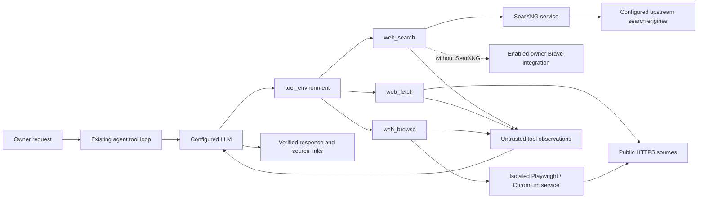

# Public web research

Lonora exposes three complementary public-web operations through the existing
agent tool registry. The model decides which operation the owner's request needs;
there is no separate keyword router or fixed research workflow.

| Operation | Actual purpose | Backend |
| --- | --- | --- |
| `web_search` | Discover sources from a query and return bounded title, URL and excerpt results | Operator-configured SearXNG; the existing enabled owner Brave Search integration remains supported when SearXNG is not configured |
| `web_fetch` | Read lightweight HTML or text from a known public HTTPS URL | Existing bounded HTTP reader; HTML scripts and styles are omitted |
| `web_browse` | Render JavaScript and inspect or interact with public page controls | Isolated Playwright and Chromium service |

Search results, fetched text and browser output are untrusted evidence. A search
excerpt does not establish that the model read the full page. The tools return
source information and observation times so the model can cite what was actually
retrieved.

## Runtime path

The existing gateway creates an owner-scoped `ToolContext`. The configured
`searxng_url` and `browser_url` reach that context through `OwnerServices`; owners
cannot supply an arbitrary internal service endpoint as a tool argument.

The model sees the current capability inventory and can load the exact operation
schema with `tool_environment`. The ordinary tool loop executes the operation and
returns its observation to the model. Research remains separate from trade
execution, account authority and financial permissions.



Implementation entry points are `packages/tools/src/lonora_tools/search.py`,
`browser.py` and `browser_service.py`, `packages/tools/src/lonora_tools/loader.py`,
and `packages/gateway/src/lonora_gateway/runtime.py`. Research guidance lives in
`packages/agent-runtime/resources/skills/research/SKILL.md` and the research section
of `packages/agent-runtime/resources/system/lonora.md`. The policy manifest is
generated by `scripts/export_agent_tool_reference.py` from the live registry.

## Configuration and readiness

The runtime accepts operator configuration through:

```dotenv
LONORA_SEARXNG_URL=http://searxng:8080
LONORA_BROWSER_URL=http://browser:8090
```

These are private service addresses, not model-supplied browsing targets. For
non-Compose installations, set them to the corresponding trusted internal
services. A missing or unreachable service produces a tool error; registration,
a configuration value or a running container alone does not prove successful
external research.

The optional deployment overlay starts the private services and connects the
gateway to their dedicated bridge:

```bash
docker compose -f infra/compose/docker-compose.prod.yml \
  -f infra/research/compose.research.yml up -d
```

Use the same deployment environment and reviewed image as the base production
composition. The overlay publishes no search/browser host ports and gives those
services no database network, application secrets or application data volumes.
The operator-owned SearXNG settings are in `infra/research/searxng.yml`. A
nonstandard deployment must retain the same isolation rather than attach the
browser to the database bridge or inherit the gateway's environment file.

SearXNG must enable its JSON search response format and have reachable upstream
engines. Its own `/search` request is executed by the server, without giving the
model a paid search credential. Source coverage and upstream availability depend
on the engines configured in that instance. Open-source software does not remove
hosting costs or upstream rate limits. The optional Brave path continues to use
the owner's encrypted integration secret through the existing secret store.

The browser service listens on port `8090`, exposes `GET /health` and accepts
the internal `POST /browse` RPC. It requires system Chromium and the existing
Playwright dependency. `BROWSER_EXECUTABLE` selects the operator-installed
Chromium executable; `BROWSER_SANDBOX` controls Chromium's sandbox. The service
must be isolated from application credentials, account databases, artifact
volumes and public ingress. Its internal RPC is not an owner-facing browser API.

## Browser contract

`web_browse` accepts a public HTTPS `url` and up to eight bounded actions:

- `click`: use a CSS selector returned in the inspected page's controls or links.
- `fill`: enter text into a page control for research; no credentials.
- `scroll`: inspect another portion of the page.
- `wait`: allow a bounded interval for JavaScript-rendered content.

Every call starts from a fresh browser context. A follow-up call must include the
target URL and necessary actions again; it does not resume a logged-in desktop,
share an owner's cookies or persist a browser profile. The returned observation
includes the final source URL, title, observation time, visible text, bounded
links and controls with selectors, and the number of blocked requests.

The browser boundary permits public HTTPS reading and blocks unsupported
protocols, private addresses, external non-read HTTP methods, WebSockets, service
workers and downloads. Redirect targets and subresources are subject to the same
network boundary. Browsing does not authorize login, purchases, sending messages,
changing external data or executing trades. Sites requiring those operations may
remain unavailable. The ordinary `web_fetch` reader retains its own lightweight
contract and does not follow redirects.

Main-document redirects preserve the real final URL and origin. Redirected
script or stylesheet bodies are fulfilled at their original resource URL;
relative imports inside those redirected resources may therefore fail on some
sites. Pages that require authenticated state, unsupported requests or anti-bot
challenges are not guaranteed to load.

## Verification

Meaningful verification checks the boundary and the actual outcome separately:

1. Validate the tool registry, installed policy resources and generated routing
   manifest.
2. Exercise search result parsing, configured-provider selection and provider
   failures with focused tests.
3. Exercise browser JavaScript rendering, bounded page actions, context cleanup,
   and blocked private or non-read network operations.
4. Call the deployed tools against actual public sources; confirm source URLs,
   nonempty content, and returned search results rather than a success-shaped
   status alone.
5. Where a configured model is available, confirm that a real model chooses the
   research operation, reads its result and answers with the observed evidence.

Mocked tests establish internal behavior, not live upstream availability. A
health check establishes service reachability, not the correctness of every
public website or the completeness of search results. Record executed live
checks separately; do not describe an unconfigured installation as operational.

The implementation passed 107 targeted tests, including real Chromium rendering
against controlled responses, plus `bash scripts/build.sh`. An actual local
SearXNG instance returned public search results without a search API key; the
agent's `web_search` handler returned eight attributed results including the
official Python source. Public-address-pinned reads also returned real content
from Python documentation and the JavaScript quotation test site on the VPS.
These checks are separate from the real-model acceptance journeys
`web_research` and `web_browser` in `scripts/verify_agent_journeys.py`, which must
be explicitly enabled with `--allow-live-model` after service configuration.

## Deployed verification on 2026-11-03

The private services were deployed and exercised through the installed gateway
tools. Search returned eight real sources, including official Python
documentation, in one measured 1.04-second request. The result correctly marked
partial upstream-engine coverage. The anonymous browser rendered the JavaScript
quotation page in one measured 2.72-second request; clicking its Next link and
waiting for JavaScript returned the second page's actual quotations. A private
URL was blocked. Container inspection confirmed no application credentials,
application mounts, database network or published host port in the browser.
These timings describe individual observations, not latency guarantees.

The real configured GPT-5.1 model then completed both Arabic acceptance journeys
through `execute_run`, ordinary progressive discovery and persisted tool/reply
state:

- `web_research`: used `web_search`, received eight SearXNG sources, read the
  official Python page with `web_fetch`, and included that actual URL in its
  persisted reply; one measured run took 11.15 seconds.
- `web_browser`: used `web_browse`, read JavaScript-rendered content and identified
  the first quotation's author with its actual source URL; one measured run took
  8.06 seconds.

An earlier general research request validly selected the browser directly for a
known source. The search-specific acceptance request explicitly asks for search
then source reading so the check verifies that path without imposing a fixed
workflow on normal agent requests. Both successful runs removed their temporary
diagnostic rows/files and exposed no financial or broker capability. Public
health/readiness and unchanged Web assets were also verified after deployment.
